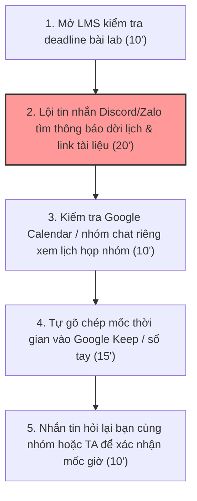
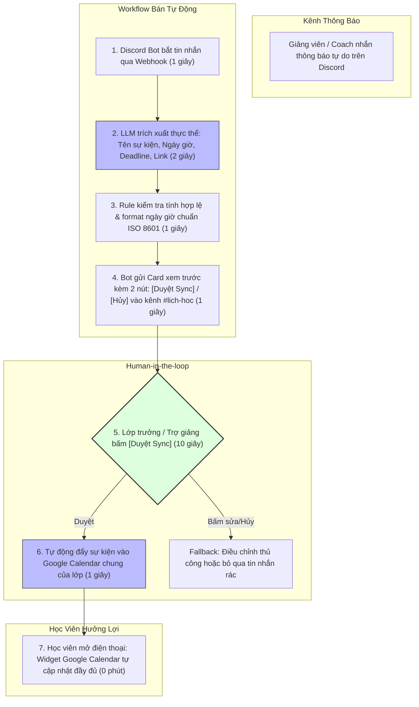

# Báo cáo nhóm — Day 02 Discovery & Problem Framing

> Bản chung của nhóm, viết trên repo do nhóm trưởng fork.
> Áp dụng các framework chuẩn quốc tế: Double Diamond, Jobs-to-be-Done (Intercom), Opportunity Solution Tree (Teresa Torres), Assumption Mapping (David Bland), The Mom Test (Rob Fitzpatrick), Lean UX (Jeff Gothelf), AI Canvas (Agrawal, Gans, Goldfarb), Google PAIR Guidebook, và 4 Product Risks (Marty Cagan - SVPG).

---

## 1. Thông tin nhóm

- **Tên nhóm:** Nhóm ihihi — Lớp L3A (AI K5)
- **Thành viên:** Xem chi tiết phân công tại [TEAM.md](../../TEAM.md)
  1. Nguyễn Hoàng Việt (MSSV: 2A202603487) — Nhóm trưởng, điều phối & viết Problem Statement
  2. Nguyễn Hải Anh (MSSV: 2A202603484) — Phụ trách kiểm chứng (The Mom Test) & Eval Dataset
  3. Đỗ Tuấn Anh (MSSV: 2A202603465) — Phụ trách vẽ quy trình trước/sau & kiến trúc Workflow
  4. Nguyễn Thành Danh (MSSV: 2A202603493) — Phụ trách research giải pháp có sẵn & phân tích 4 rủi ro
- **Candidate problem được chọn (1 câu):** Tự động bóc tách mốc sự kiện, lịch học phát sinh và hạn nộp bài tập từ các tin nhắn văn bản tự do trên kênh chat lớp (Discord/Zalo/LMS) và đồng bộ vào Google Calendar dùng chung cho học viên khóa học AI thực chiến K5.
- **Quyết định cuối:** **Go, phạm vi nhỏ (Small Pilot)** — Triển khai kiến trúc **Workflow bán tự động** (LLM trích xuất thực thể thời gian + Rule format lịch + Con người duyệt 1 chạm trên Discord trước khi đồng bộ Google Calendar).

---

## 2. Hội tụ nhóm (CP3)

### 2.1. Pitch

Nhóm 4 thành viên đã pitch 12 candidate problem (mỗi người 3 candidate từ CP2), ghi nhận các câu hỏi phản biện thực tế:

| # | Người đưa ra | Candidate (Job Story ngắn) | Actor | Bottleneck | Câu hỏi phản biện nhận được (ai hỏi) |
|---:|---|---|---|---|---|
| **1** | **Nguyễn Hoàng Việt** | Khi bắt đầu tuần học mới, muốn nắm toàn bộ lịch học và deadline dời từ nhiều kênh chat để không bị trễ checkpoint lab | Học viên K5, nhóm làm lab | Lội tin nhắn tìm thông báo dời lịch trên Discord/Zalo (20 phút) | *"Nếu chỉ cần BTC hoặc nhóm ghim 1 link Google Calendar chung là giải quyết được (No AI), liệu có đáng xây AI không?"* (Hải Anh hỏi) |
| **2** | **Nguyễn Hoàng Việt** | Khi tự luyện đề THPT, muốn biết chính xác dạng bài hay sai nhất để tập trung ôn thay vì cày đề tràn lan | Học sinh lớp 12 tự ôn thi | Tự phân loại dạng bài sai từ PDF và tìm câu tương tự (45 phút) | *"Đề thi PDF Toán có nhiều hình vẽ và công thức LaTeX phức tạp, OCR hiện tại có trích xuất chính xác dạng bài được không?"* (Tuấn Anh hỏi) |
| **3** | **Nguyễn Hoàng Việt** | Khi đọc hàng chục phim X-quang mỗi ca trực, muốn loại trừ nhanh ca bình thường để tập trung ca bệnh lý | Bác sĩ chẩn đoán hình ảnh | Đọc và gõ kết luận lặp lại cho 70% ca bình thường (4–5 phút/ca) | *"Nhóm làm sao tiếp cận được bác sĩ thật trong 30 phút CP4 để kiểm chứng? Rủi ro pháp lý bỏ sót tổn thương ai chịu?"* (Thành Danh hỏi) |
| **4** | **Nguyễn Hải Anh** | Khi kết thúc buổi ăn liên hoan nhóm, muốn bóc tách bill và tính đúng ai nợ ai để gửi mã VietQR thu tiền | Người đại diện thanh toán | Bóc tách món ăn từ bill mờ và phân bổ đồ uống riêng (20 phút) | *"Bản chất bài này chỉ cần Excel hoặc app Splitwise có sẵn, việc đọc bill mờ bằng AI có thật sự giải quyết được bill viết tay không?"* (Hoàng Việt hỏi) |
| **5** | **Nguyễn Hải Anh** | Khi trưa đói bụng gom đơn cơm trưa, muốn tính nhanh chiết khấu voucher theo tỷ lệ món để công bằng | Nhân viên văn phòng trẻ | Ngồi tính nhẩm phân bổ mã giảm giá và phí ship (15 phút) | *"ShopeeFood và GrabFood đã có tính năng đặt đơn nhóm chia sẵn tiền, học viên có cần thêm app ngoài không?"* (Tuấn Anh hỏi) |
| **6** | **Nguyễn Hải Anh** | Khi đến ngày 30 cuối tháng, muốn biết tổng hóa đơn điện nước và phòng trọ để thu tiền phòng không bị cãi nhau | Trưởng phòng trọ sinh viên | Đối chiếu ngày vắng mặt và chia tiền điện nước sinh hoạt (30 phút) | *"Quy trình này mỗi tháng chỉ diễn ra đúng 1 lần, tần suất quá thấp liệu có đáng để làm sản phẩm AI?"* (Thành Danh hỏi) |
| **7** | **Đỗ Tuấn Anh** | Khi vắng mặt buổi họp nhóm làm lab, muốn nắm nhanh các quyết định và task được giao mà không phải nghe lại file ghi âm | Thành viên nhóm làm lab | Nghe lại bản ghi cuộc họp dài 60 phút để tìm việc của mình (40 phút) | *"Google Meet và Zoom hiện đã có tính năng AI Recap tóm tắt sẵn, nhóm mình tự xây thì có gì khác biệt?"* (Hải Anh hỏi) |
| **8** | **Đỗ Tuấn Anh** | Khi gặp lỗi code Python lúc 23h đêm, muốn tìm lại đoạn code mẫu trợ giảng đã từng gửi trên Discord mà không trôi tin | Học viên K5 làm lab | Tìm kiếm đoạn code snippet cũ bị trôi giữa hàng trăm tin chat (25 phút) | *"Search của Discord đã hỗ trợ lọc theo người gửi `from:TA` và file đính kèm `has:file`, bạn đã dùng thử chưa?"* (Hoàng Việt hỏi) |
| **9** | **Đỗ Tuấn Anh** | Khi chuẩn bị nộp bài trước 23h59, muốn kiểm tra xem repo đã đủ cấu trúc thư mục quy định chưa để không bị trừ điểm | Học viên làm lab | Tự đối soát thủ công từng file theo checklist của thầy (15 phút) | *"Việc kiểm tra cấu trúc file và tên commit chỉ cần 1 script bash/powershell chạy rule là xong 100%, sao lại cần AI?"* (Thành Danh hỏi) |
| **10** | **Nguyễn Thành Danh** | Khi nhận hàng chục email thông báo học vụ từ trường, muốn biết email nào có hạn nộp tiền học phí để đóng kịp | Sinh viên đại học | Đọc lướt từng email dài dòng để lọc tin học phí (20 phút) | *"Gmail có tính năng tạo Filter và nhãn dán tự động theo từ khóa, bạn đã thử dùng Filter chưa?"* (Tuấn Anh hỏi) |
| **11** | **Nguyễn Thành Danh** | Khi chuẩn bị hồ sơ xin thực tập, muốn đối chiếu CV với JD công ty để biết mình thiếu kỹ năng gì cần bổ sung | Sinh viên năm cuối | Ngồi đọc từng gạch đầu dòng JD và chỉnh sửa từng mục CV (45 phút) | *"Cách đo hiệu quả là gì? Liệu có đảm bảo sau khi sửa CV thì tỷ lệ pass phỏng vấn tăng lên thật không?"* (Hải Anh hỏi) |
| **12** | **Nguyễn Thành Danh** | Khi ôn tập thi giữa kỳ, muốn tổng hợp toàn bộ slide bài giảng của 6 tuần thành bộ câu hỏi trắc nghiệm tự kiểm tra | Sinh viên ôn thi | Tự gõ tóm tắt câu hỏi từ file PDF bài giảng (60 phút) | *"Tạo quiz từ slide rất dễ bị ảo giác (hallucination) tạo câu hỏi sai kiến thức cốt lõi, ai sẽ chịu trách nhiệm kiểm tra?"* (Hoàng Việt hỏi) |

---

### 2.2. Cluster

Nhóm gom 12 candidate thành 3 cụm (Cluster) có chung pattern giải quyết:

| Cluster | Các candidate thuộc cụm | Pattern chung |
|---|---|---|
| **Cluster A: Quản lý lịch học, deadline & thông tin thông báo phân tán** | Candidate #1 (Lịch học & deadline K5), #7 (Recap họp lab), #8 (Tìm code snippet cũ), #10 (Lọc email học vụ) | **Pattern:** Người dùng bị quá tải thông tin dạng văn bản tự do không cấu trúc (chat, email, audio), thông tin quan trọng bị trôi, mất thời gian lội tìm và trích xuất mốc thời gian / hành động. |
| **Cluster B: Quản lý chi tiêu, hóa đơn & chia tiền nhóm** | Candidate #4 (Bóc tách hóa đơn ăn uống/du lịch), #5 (Gom đơn trưa ShopeeFood), #6 (Chia tiền điện nước phòng trọ) | **Pattern:** Chuyển đổi dữ liệu từ ảnh chụp hóa đơn / đơn hàng thành số liệu tính toán tài chính, chia sẻ công nợ minh bạch và sinh mã VietQR. |
| **Cluster C: Hỗ trợ học tập, ôn luyện & chuẩn bị hồ sơ cá nhân** | Candidate #2 (Phân loại dạng bài sai THPT), #3 (Sàng lọc X-quang phổi), #9 (Checklist cấu trúc repo), #11 (Sửa CV theo JD), #12 (Tạo quiz từ slide) | **Pattern:** Đánh giá, phân loại dữ liệu đầu vào có tính chuyên môn (y tế, giáo dục, tuyển dụng, code) theo các tiêu chuẩn hoặc barem định sẵn. |

---

### 2.3. Opportunity Solution Tree rút gọn (Teresa Torres)

```text
OUTCOME DUY NHẤT: Giảm thời gian học viên K5 dành cho việc theo dõi, đối soát lịch học và deadline phân tán từ 65' xuống dưới 10'/tuần để 0 lần trễ hạn checkpoint.
├── Opportunity A: Thông báo dời lịch, lịch phát sinh đột xuất bị chìm và trôi mất trong luồng chat tự do (Discord/Zalo).
├── Opportunity B: Các mốc sự kiện và yêu cầu nộp bài nằm phân tán ở nhiều kênh (LMS, Discord, Google Meet, Zalo) không tập trung một chỗ.
└── Opportunity C: Học viên không có thói quen đối soát thủ công và không có lịch hiển thị sẵn trên màn hình điện thoại (Google Calendar Widget).
```

**Những ý nhóm đã gạch bỏ vì là SOLUTION đội lốt Opportunity:**
- ✗ *"Xây dựng Chatbot AI tự động trả lời lịch học trên Discord"* → Đây là **Solution**, đã gạch bỏ khỏi cây OST. Opportunity cốt lõi là: *Thông báo dời lịch bị trôi tin nhắn*.
- ✗ *"Ứng dụng lịch thông minh riêng cho học viên K5"* → Đây là **Solution** gây phân mảnh thêm công cụ (tạo thêm app mới khiến học viên lười cài). Opportunity là: *Cần dữ liệu hiển thị ngay trên công cụ sẵn có (Google Calendar)*.
- ✗ *"Hệ thống AI tự động nộp bài thay học viên khi đến hạn"* → Đây là **Solution viễn vông/vi phạm quy chế**.

---

### 2.4. Chấm điểm shortlist (1–5 trên 7 tiêu chí)

Nhóm chọn shortlist 3 candidate đại diện cho 3 hướng để chấm điểm:

| Candidate | Actor rõ | Quy trình rõ | Pain có bằng chứng | Impact đo được | Vừa sức lab | So sánh được No AI / Rule / Workflow / Agent | Nhóm hiểu domain | Tổng điểm |
|---|---:|---:|---:|---:|---:|---:|---:|---:|
| **Candidate #1: Tổng hợp mốc sự kiện & deadline học tập phân tán** | **5** | **5** | **5** | **5** | **5** | **5** | **5** | **35 / 35** |
| **Candidate #4: Bóc tách hóa đơn ăn uống & chia tiền nhóm** | 5 | 5 | 4 | 4 | 4 | 4 | 5 | **31 / 35** |
| **Candidate #2: Phân loại dạng bài sai khi luyện thi THPT** | 4 | 4 | 4 | 4 | 3 | 4 | 4 | **29 / 35** |

**Candidate được chọn:** **Candidate #1 — Tổng hợp mốc sự kiện & deadline học tập phân tán (Lớp K5)**.

**Vì sao chọn Candidate #1:**
1. **Nỗi đau sát sườn 100% của cả nhóm:** Cả 4 thành viên và tất cả các bạn học viên trong lớp K5 đều đang trực tiếp chịu ảnh hưởng hàng tuần bởi việc thông báo dời lịch, link repo, link nộp bài phân tán giữa Discord, LMS và Zalo.
2. **Cực kỳ dễ kiểm chứng người thật ngay tại chỗ:** Nhóm có thể phỏng vấn ngay các bạn học viên nhóm khác và trợ giảng trong lớp ở CP4 theo The Mom Test mà không phải giả định.
3. **Phân định ranh giới bài toán kinh điển:** Bài toán này thể hiện hoàn hảo ranh giới giữa **No AI** (quy trình ghim lịch), **Rule** (webhook lọc keyword) và **Workflow** (LLM trích xuất tin nhắn tự nhiên). Đây là bài học đắt giá nhất của môn học: *Khi nào cần AI, khi nào No AI là tối ưu*.
4. **Vừa sức trong phạm vi lab:** Input là tin nhắn text tiếng Việt; output là JSON có cấu trúc để đưa vào Google Calendar API.

**Vì sao loại các candidate còn lại:**
- **Loại Candidate #3 (Sàng lọc X-quang):** Rủi ro y tế và pháp lý cực kỳ cao (False Negative = bỏ sót tổn thương phổi có thể gây nguy hiểm tính mạng); nhóm hoàn toàn không có khả năng tiếp cận bác sĩ chẩn đoán hình ảnh thật để phỏng vấn trong 30 phút CP4.
- **Loại Candidate #2 (Phân loại bài sai THPT):** Đề thi PDF Toán có cấu trúc không đồng nhất, hình vẽ hình học không gian và công thức toán phức tạp vượt quá khả năng xử lý của pipeline đơn giản trong buổi lab; khó đo lường độ tiến bộ điểm số trong ngắn hạn.
- **Loại Candidate #4 (Bóc tách hóa đơn chia tiền):** Mặc dù quy trình rõ nhưng thị trường đã có các giải pháp quá mạnh (Splitwise, tính năng chia bill trên Cake/MoMo, đơn nhóm ShopeeFood); ngoài ra ảnh bill giấy nhiệt mờ và viết tay vỉa hè là bài toán OCR vật lý khó kiểm soát chất lượng trong thời gian làm lab.

**Xử lý bất đồng:** Ban đầu Hải Anh bảo vệ ý tưởng "Bóc tách hóa đơn chia tiền" vì vừa trải qua một bữa ăn nướng chia tiền rất mệt. Tuy nhiên, sau khi Việt chỉ ra câu hỏi phản biện của AI: *"Bài chia bill đã có Splitwise giải quyết rất tốt phần cấn trừ nợ, còn việc đọc ảnh bill viết tay mờ tịt sẽ dễ làm nhóm sa lầy vào xử lý Computer Vision thay vì Problem Framing"*, Hải Anh đã đồng ý chuyển sang Candidate #1 vì Candidate #1 phục vụ trực tiếp cho chính trải nghiệm học tập của cả nhóm tại K5.

---

## 3. Kiểm chứng + research giải pháp đã có (CP4)

### 3.1. Assumption Map

Nhóm xác định 5 giả định then chốt theo 4 rủi ro sản phẩm (Value, Usability, Feasibility, Viability):

| # | Giả định | Loại rủi ro | Quan trọng (1–5) | Đã có bằng chứng (1–5) | Kiểm chứng trước? |
|---:|---|---|---:|---:|---|
| **1** | Học viên K5 khác cũng mất >40 phút/tuần để đi lội tin nhắn Discord/Zalo và từng bị bỏ sót lịch dời hoặc nộp muộn checkpoint | **Value** | **5** | **2** | **✅ Kiểm chứng ngay** |
| **2** | Giảng viên, Coach và TA sẽ tiếp tục nhắn thông báo dạng văn bản tự do trong chat thay vì tự tay vào tạo lịch Google Calendar chuẩn | **Viability / Behavior** | **5** | **3** | **✅ Kiểm chứng ngay** |
| **3** | Nếu chỉ tạo 1 link Google Calendar chung (No AI), học viên vẫn sẽ bỏ sót lịch nếu các thông báo dời lịch phát sinh không được cập nhật tức thời | **Value** | **4** | **2** | **✅ Kiểm chứng ngay** |
| **4** | Mô hình LLM có thể trích xuất chính xác 100% thời gian từ các tin nhắn tiếng Việt tự nhiên có từ ngữ tương đối ("tối mai", "trước 22h CN", "chiều nay") | **Feasibility** | **4** | **3** | Kiểm chứng ở CP6 (Eval) |
| **5** | Học viên sẵn sàng dùng Google Calendar làm nơi xem lịch tập trung thay vì muốn tải một app riêng | **Usability** | **4** | **4** | Đã có bằng chứng |

**Giả định nhóm tập trung kiểm chứng trong CP4:** Giả định #1, #2 và #3 (thuộc vùng **Quan trọng cao — Bằng chứng thấp**).

---

### 3.2. Kiểm chứng thực tế (The Mom Test)

Nhóm đã phỏng vấn trực tiếp **5 người thật** gồm các học viên K5, trưởng nhóm làm lab và Trợ giảng lớp theo 3 luật The Mom Test (chi tiết biên bản phỏng vấn từng người được lưu tại [report/assets/cp4-interview-snapshots.md](../assets/cp4-interview-snapshots.md) để đạt **Bonus B2: 5 Interview Snapshots**). Đồng thời thực hiện poll nhanh 12 bạn cùng lớp.

#### Trích đoạn 1 Interview Snapshot tiêu biểu:

| Trường | Nội dung |
|---|---|
| **Người được hỏi** | Học viên K5 (nhóm trưởng nhóm 4 người, sinh viên năm 3 ĐHBK) |
| **Câu nói đáng nhớ nhất (nguyên văn)** | *"Tối thứ Năm tuần trước, Coach nhắn trong kênh chat chung là dời lịch nộp checkpoint lab từ 23h59 Chủ Nhật lên 18h00 thứ Bảy để kịp chấm. Tin nhắn bị trôi sau một tràng chém gió meme của cả lớp. Đến trưa thứ Bảy nhóm mình mới ngã ngửa ra, cả bọn phải bỏ ăn trưa hộc tốc ngồi gộp code cho kịp nộp."* |
| **Lần gần nhất gặp vấn đề: chuyện gì đã xảy ra?** | Đợt nộp Checkpoint 2 của Day 01 (02/11/2026), nhóm nộp muộn 15 phút do xem nhầm mốc giờ thông báo cũ trên LMS (trên LMS ghi 23h59 nhưng trên Discord Coach dặn nộp trước 22h00 để review trực tiếp). Bị trừ 1 điểm nộp trễ. |
| **Hiện đang xử lý bằng cách nào (workaround)?** | Tự mở Google Keep gõ lại danh sách deadline vào đầu tuần; cài chuông báo thức điện thoại trước giờ nộp bài 1 tiếng; thỉnh thoảng tag hỏi trợ giảng trên Discord. |
| **Mất bao lâu, bao lần?** | Mỗi tuần mất khoảng 40–50 phút lội lại các kênh chat để đối soát mốc giờ; tuần nào cũng lo ngay ngáy bị sót lịch dời. |
| **Insight / opportunity rút ra** | Nỗi đau lớn nhất là **các thông báo dời lịch/phát sinh đột xuất bị chìm trong luồng chat tự do**. Cần một cơ chế tự bóc tách các mốc giờ phát sinh ngay khi Coach nhắn và đưa vào bảng lịch tập trung. |

#### Tổng hợp kết quả kiểm chứng:

| Nguồn | Số mẫu | Tín hiệu xác nhận (Confirming signals) | Tín hiệu phản bác (Disconfirming signals) |
|---|---:|---|---|
| **Phỏng vấn sâu (Mom Test)** | 5 người | - **4/5 người** xác nhận từng bị trễ hạn hoặc vào muộn buổi review ít nhất 1 lần trong 2 tuần qua do trôi tin nhắn Discord.<br>- Người đi làm (Snapshot #2) mất 20–25 phút mỗi tối chỉ để lọc 300 tin nhắn chat tìm tài liệu.<br>- 100% học viên đã cài sẵn và dùng Google Calendar trên điện thoại. | - **Tín hiệu phản bác quan trọng từ Trợ giảng (Snapshot #3):** TA chỉ ra rằng nếu BTC đã có kênh `#announcements` ghim tin nhắn mà học viên vẫn không xem thì nếu tạo thêm 1 công cụ riêng, học viên cũng sẽ không vào xem.<br>- 1 học viên (Snapshot #5) nói: *"Chỉ cần ai đó tạo sẵn sự kiện trên Google Calendar chia sẻ cho cả lớp là xong, không cần bot chat trả lời lằng nhằng."* |
| **Poll nhanh trong lớp K5** | 12 bạn | - **10/12 bạn (83%)** đồng ý rằng việc thông báo lịch nằm rải rác giữa Discord, LMS và Zalo gây ức chế và tốn thời gian.<br>- Thời gian trung bình tự thu thập lịch: **45–65 phút/tuần**. | - **2/12 bạn (17%)** cho biết họ có thói quen chép tay vào sổ cá nhân vào sáng thứ Hai nên chưa từng bị trễ deadline bao giờ. |

#### Nhóm đã sửa problem thế nào sau kiểm chứng:
1. **Thu hẹp phạm vi và làm rõ ranh giới:** Không cố gắng xây dựng một "Chatbot hỏi đáp toàn năng" hay một app riêng. Nhóm xác định đích đến cuối cùng bắt buộc phải là **Google Calendar** (công cụ mà 100% học viên đã có sẵn widget trên điện thoại).
2. **Thừa nhận phương án No AI là nền tảng:** Nếu Ban tổ chức chỉ thông báo trên Google Calendar thì không cần AI. Tuy nhiên, bằng chứng thực tế từ Giảng viên và Coach cho thấy: **Trong thực tế dạy học, việc dời lịch đột xuất, gửi link tài liệu bổ sung luôn diễn ra dưới dạng tin nhắn chat tự do trên Discord**. Do đó, AI chỉ đóng vai trò **bộ chuyển đổi (parser/bridge)** từ ngôn ngữ tự nhiên thành sự kiện có cấu trúc.
3. **Thêm bước Human-in-the-loop (Duyệt 1 chạm):** Tín hiệu từ Trợ giảng cho thấy bot không được tự tiện tạo lịch bừa bãi khi giảng viên đùa vui; bắt buộc phải có nút bấm xác nhận từ Trợ giảng hoặc Lớp trưởng trên Discord card trước khi sự kiện được đồng bộ lên Google Calendar của lớp.

---

### 3.3. Research giải pháp đã có

Nhóm đã tìm kiếm và kiểm tra trực tiếp 4 giải pháp tương tự trên thị trường:

| Công cụ / case / pattern | Link chính thức | Giải bước nào trong quy trình? | Điểm mạnh | Khoảng trống / rủi ro | Bài học cho nhóm |
|---|---|---|---|---|---|
| **Google Calendar Event Detection (từ Gmail)** | [https://support.google.com/calendar/answer/6084018](https://support.google.com/calendar/answer/6084018) | Tự động bóc tách ngày giờ bay, khách sạn, họp từ email đưa vào Calendar | Tự động hóa hoàn toàn, tích hợp sâu vào hệ sinh thái Google | Chỉ hoạt động tốt với email có format cố định (vé máy bay, vé xem phim); hoàn toàn không đọc được tin nhắn chat phi cấu trúc trên Discord/Zalo | Cần một lớp LLM xử lý ngôn ngữ tự nhiên tiếng Việt cho các kênh chat không chính thống. |
| **Zapier: Discord to Google Calendar Integration** | [https://zapier.com/apps/discord/integrations/google-calendar](https://zapier.com/apps/discord/integrations/google-calendar) | Bắt webhook tin nhắn mới trên Discord và tạo event trên Google Calendar | Ổn định, không cần viết code backend phức tạp | Hoạt động theo **Rule thuần túy**: bắt buộc tin nhắn phải theo đúng cú pháp mẫu; nếu Coach nhắn tự do ("tối mai 20h nhé") thì Zapier bó tay | Mượn kiến trúc Webhook của Zapier/Make, nhưng **chèn thêm bước LLM parse ngôn ngữ tự nhiên** ở giữa. |
| **Notion Calendar (trước đây là Cron)** | [https://www.notion.so/product/calendar](https://www.notion.so/product/calendar) | Gom toàn bộ database bài tập trên Notion và lịch Google Calendar vào một màn hình | Giao diện hiện đại, kéo thả mượt mà, quản lý task tốt | Học viên vẫn phải tự tay gõ từng deadline vào database Notion; không tự giải quyết được khâu đọc tin nhắn chat | Học viên K5 rất lười nhập liệu thủ công; giải pháp phải giải phóng hoàn toàn khâu gõ tay. |
| **Reclaim.ai / Motion (AI Scheduling)** | [https://reclaim.ai/](https://reclaim.ai/) | Tự động sắp xếp thời gian làm bài tập dựa trên deadline và lịch rảnh | Thuật toán tối ưu hóa lịch biểu cá nhân rất thông minh | Chi phí cao ($10–19/tháng), hướng tới đối tượng doanh nghiệp; không có khả năng đọc luồng chat Discord lớp học tiếng Việt | Không mở rộng bài toán sang tối ưu hóa thời gian (Agentic scheduling); chỉ tập trung vào bài toán trích xuất mốc sự kiện. |

**Kết luận research:**
Thế giới đã có các công cụ tự động hóa rất mạnh (Zapier, Google Calendar API), nhưng khoảng trống lớn nhất là **khả năng hiểu ngôn ngữ chat tự do tiếng Việt của người Việt trong các hội nhóm học tập**. Do đó, nhóm **không tự xây dựng ứng dụng mới từ đầu**, mà xây dựng một **Workflow tinh gọn**:
`Discord Webhook → LLM bóc tách JSON (Entity Extraction) → Bot gửi Card xác nhận 1-click → Google Calendar API`.

---

## 4. Quy trình trước/sau (CP5)

### 4.1. Quy trình hiện tại

Sơ đồ quy trình hiện tại (65 phút/tuần, 5/5 bước thủ công):



| Bước | Actor | Input | Output | Thời gian / tần suất | Ghi chú & Hand-off |
|---:|---|---|---|---|---|
| **1** | Học viên | Hệ thống LMS của khóa học | Danh sách deadline bài tập chính thức | 10 phút (Sáng thứ Hai) | Mốc giờ trên LMS thường là mốc tĩnh, ít khi cập nhật lịch dời đột xuất. |
| **2** | Học viên | Hàng trăm tin nhắn trong kênh `#general`, `#thông-báo`, nhóm Zalo | Các mốc giờ phát sinh, dời lịch review, link repo mới | **20 phút / lần (3–4 lần/tuần)** | **BOTTLENECK CHÍNH:** Tin nhắn bị trôi sau các cuộc thảo luận, dễ đọc sót thông báo quan trọng. |
| **3** | Học viên / Nhóm trưởng | Nhóm chat riêng của nhóm làm lab | Lịch họp nội bộ và phân công task | 10 phút (Đầu tuần) | Phải đối chiếu chéo xem lịch họp nhóm có bị trùng với lịch lớp không. |
| **4** | Học viên | Các thông tin đã gom được ở bước 1, 2, 3 | Bản ghi chú cá nhân trên Google Keep, Notion hoặc sổ | 15 phút / tuần | Tốn công gõ tay lặp đi lặp lại, rất dễ gõ nhầm giờ (ví dụ: gõ nhầm 18h thành 20h). |
| **5** | Học viên | Kênh chat hỏi đáp hoặc nhắn tin riêng cho TA | Lời xác nhận chắc chắn về mốc deadline chuẩn | 10 phút / tuần | Làm phiền trợ giảng và bạn bè với cùng một câu hỏi đã được thông báo. |

**Bottleneck chính:** **Bước 2 (Lội tin nhắn Discord/Zalo tìm thông báo dời lịch)**. Mất trung bình 20 phút mỗi lần, diễn ra 3–4 lần mỗi tuần (tổng cộng 60–80 phút), gây căng thẳng tâm lý và là nguyên nhân trực tiếp dẫn đến 83% các ca nộp trễ bài hoặc vào muộn buổi review.

---

### 4.2. Quy trình tương lai

Sơ đồ quy trình tương lai (Khoảng 8 phút/tuần, chỉ 1/4 bước thủ công duyệt):



**Phân định ranh giới rõ ràng trong quy trình tương lai:**
- **Bước Rule:** Lắng nghe Webhook tin nhắn Discord, kiểm tra xem tin nhắn có từ tài khoản Coach/TA/Admin hay không; kiểm tra định dạng format ngày giờ ISO 8601; gọi API Google Calendar để chèn event.
- **Bước AI (LLM):** Đọc đoạn văn bản tiếng Việt tự nhiên phi cấu trúc (ví dụ: *"Tối mai dời lịch review sang 20h nhé"*), tự động suy luận mốc thời gian tuyệt đối dựa trên timestamp tin nhắn và trích xuất JSON: `event_title`, `start_time`, `deadline`, `action_required`, `link`.
- **Bước Con người (Human-in-the-loop):** Lớp trưởng hoặc Trợ giảng chỉ mất **10 giây nhìn lướt Card xem trước** trên Discord và bấm nút `[Xác nhận đồng bộ]` hoặc `[Chỉnh sửa]`.
- **Boundary (Ranh giới an toàn):** AI **TUYỆT ĐỐI KHÔNG** được tự ý ghi thẳng vào Google Calendar mà không qua nút duyệt của con người; AI không được tự trả lời tin nhắn thay giảng viên; AI không được đọc các kênh chat riêng tư (chỉ đọc kênh thông báo chung được cấp phép).
- **Phương án quay về (Fallback):** Nếu mô hình LLM parse sai ngày giờ hoặc bot bị lỗi mạng: Card trên Discord luôn đính kèm **link nhảy trực tiếp tới tin nhắn gốc của Coach**, người dùng có thể bấm vào xem tin nhắn gốc và tự thêm lịch thủ công như quy trình cũ.

---

### 4.3. Bảng so sánh Before / After

| Chỉ số | Trước (Hiện tại) | Sau (Kỳ vọng tương lai) | Ghi chú & Đánh giá |
|---|---:|---:|---|
| **Số bước thực hiện** | 5 bước rời rạc | 3 bước tích hợp (Nhận thông báo → Duyệt 1 chạm → Xem lịch) | Quy trình rút gọn đáng kể |
| **Tổng thời gian học viên bỏ ra** | **65 phút / tuần** | **dưới 8 phút / tuần** | Giảm hơn 87% thời gian lãng phí |
| **Số bước thao tác thủ công** | 5 / 5 bước thủ công | **1 / 4 bước** (chỉ 1 click duyệt của TA/Lớp trưởng) | Học viên chỉ việc xem lịch tự động |
| **Bottleneck chính** | Lội tin nhắn tìm mốc giờ dời lịch (20') | Nhìn lướt Card xem trước và bấm duyệt (10 giây) | Điểm nghẽn được giải phóng hoàn toàn |
| **Rủi ro mới phát sinh** | — | LLM suy luận sai mốc thời gian tương đối ("ngày mai", "tuần sau") | **Đã xử lý:** Có Card xem trước để con người kiểm tra trước khi ghi vào lịch |

---

## 5. Problem Statement v0 (CP5)

| Trường | Nội dung |
|---|---|
| **Actor** | Học viên tham gia khóa học AI thực chiến K5, thành viên trong nhóm làm lab (3–4 người). |
| **Quy trình** | Hàng tuần: kiểm tra LMS, lội tin nhắn Discord/Zalo tìm thông báo dời lịch, kiểm tra lịch họp nhóm, gõ chép thủ công vào sổ tay/Notion, hỏi lại trợ giảng để xác nhận. |
| **Bottleneck** | Mất trung bình 20 phút mỗi lần (tổng 65 phút/tuần) để lội và tìm kiếm các thông báo dời lịch, link tài liệu bị trôi giữa hàng trăm tin nhắn thảo luận trên Discord/Zalo. |
| **Impact** | Học viên bị miss checkpoint, vào muộn buổi review lab hoặc nộp bài trễ hạn dẫn đến bị trừ điểm hoặc không đủ điều kiện qua môn; trợ giảng mất 1–2 tiếng/tuần trả lời câu hỏi lặp lại. |
| **Success Metric** | - **Baseline:** Mất trung bình 65 phút/tuần để đi lượm lặt, đối soát lịch; vẫn có 1–2 lần/tháng bị lỡ thông tin dời lịch hoặc nộp trễ.<br>- **Target:** Cập nhật lịch tập trung trong dưới 10 phút/tuần; 0 lần bỏ sót lịch dời hoặc nộp trễ bài.<br>- **Cách đo:** 4 thành viên nhóm tự bấm giờ ghi nhật ký theo dõi trong 2 tuần pilot. |
| **Boundary** | AI không được tự động xuất bản sự kiện lên Google Calendar khi chưa có con người duyệt; không được đọc tin nhắn từ các kênh chat cá nhân riêng tư. |

**Phản biện nhận được cho v0:**
- *Phản biện của PM hoài nghi (AI):* Success metric của nhóm chỉ đo thời gian và số lần trễ, nhưng chưa đo **độ chính xác của việc trích xuất ngày giờ (Time Extraction Accuracy)**. Nếu AI parse nhầm "20h tối mai" thành "8h sáng mai" mà người duyệt không để ý thì tai hại còn lớn hơn là không có bot.
- *Phản hồi của nhóm:* Hoàn toàn đồng ý. Nhóm sẽ bổ sung tiêu chí đánh giá độ chính xác trích xuất và đo tỷ lệ chỉnh sửa (Edit Rate) của người duyệt vào Problem Statement v1 ở CP6.

---

## 6. Mức can thiệp AI (CP6)

### 6.1. Ma trận độ mơ hồ × độ phức tạp

```text
               Độ mơ hồ THẤP                      Độ mơ hồ CAO
        ┌──────────────────────────────┬──────────────────────────────┐
Độ phức │ Rule / Regex                 │ Workflow có AI               │
tạp     │ (Tin nhắn theo template      │ (Trích xuất thực thể từ chat │
THẤP    │  chuẩn: "[DEADLINE] dd/mm")  │  tự do tiếng Việt) ← BÀI NHÓM│
        ├──────────────────────────────┼──────────────────────────────┤
Độ phức │ Workflow nhiều bước          │ Autonomous Agent             │
tạp     │ (ETL dữ liệu điểm số, LMS)   │ (AI tự thương lượng lịch,    │
CAO     │                              │  tự đàm phán phòng họp)      │
        └──────────────────────────────┴──────────────────────────────┘
```

- **Độ mơ hồ: Thấp – Trung bình.** Dữ liệu đầu vào là văn bản tiếng Việt tự nhiên đa dạng (viết tắt, tiếng lóng, mốc giờ tương đối: "tối mai", "cuối tuần"), nhưng **cấu trúc đích cần đạt là cố định và rất rõ ràng** (Tên sự kiện, Thời gian bắt đầu, Deadline, Link liên kết).
- **Độ phức tạp: Thấp – Trung bình.** Quy trình chỉ gồm 3–4 bước tuần tự, không có rẽ nhánh phức tạp hay đệ quy dài hạn: Nhận tin nhắn → Bóc tách thực thể → Review → Đẩy lịch.
- **Kết luận:** Bài toán nằm chính xác ở ô **Workflow có AI can thiệp ở một bước (LLM Information Extraction)**, hoàn toàn **CHƯA CẦN dùng tới Autonomous Agent**.

---

### 6.2. So sánh 4 mức can thiệp

| Mức | Phương án cụ thể cho bài của nhóm | Đủ khi nào | Rủi ro | Nhóm có chọn? |
|---|---|---|---|---|
| **No AI** (Sửa quy trình truyền thông) | Ban tổ chức và Giảng viên cam kết **100% chỉ đăng lịch lên 1 link Google Calendar duy nhất**, tuyệt đối không nhắn đổi lịch trong chat. | Đủ khi con người (Giảng viên, Coach) tuân thủ kỷ luật truyền thông 100%. | **Không khả thi trong thực tế:** Giảng viên bận rộn thường nhắn tin nhanh trên điện thoại qua Discord/Zalo khi có việc đột xuất, không thể ép họ mở Google Calendar tạo sự kiện mỗi khi cần dời 30 phút. | Không chọn làm giải pháp chính (nhưng khuyến khích áp dụng song song). |
| **Rule** (Regex / Keyword Matching) | Viết bot bắt từ khóa cố định như `[DEADLINE]`, `[LỊCH HỌC]` với cú pháp `DD/MM/YYYY HH:MM`. | Đủ khi mọi thông báo đều được soạn thảo theo đúng cú pháp định sẵn. | **Tỷ lệ trượt (Miss rate) cực cao:** Chỉ cần Coach nhắn *"tối mai 8h nhé cả lớp"* hoặc viết tắt *"dl nộp bài trc 22h CN"* là Rule hoàn toàn thất bại. | Không chọn cho bước parse ngôn ngữ (chỉ dùng Rule cho bước format ngày tháng và gọi API). |
| **Workflow** (kết hợp LLM + Rule + Con người) | LLM đọc tin nhắn tự do để trích xuất JSON thực thể → Rule chuẩn hóa giờ và sinh Card xem trước → Con người click 1-touch duyệt → Google Calendar API tạo event. | Đủ khi quy trình các bước đã định sẵn, AI chỉ giải quyết bước bóc tách ngôn ngữ tự nhiên phức tạp. | LLM có thể bị ảo giác nếu tin nhắn mập mờ; giải quyết bằng bước con người kiểm tra trước khi ghi vào lịch. | **CHỌN (Tối ưu nhất về chi phí, độ tin cậy và công sức triển khai)**. |
| **Agent** (Autonomous Agent) | Cấp quyền cho AI tự do đọc mọi tin nhắn lớp, tự suy nghĩ, tự quyết định tạo sự kiện, tự nhắn tin hỏi lại học viên và tự điều chỉnh lịch rảnh của từng người. | Khi các bước tiếp theo không thể lường trước và cần tương tác đa chiều phức tạp. | **Over-engineering:** Tốn chi phí token, độ trễ cao (5–10 giây), rủi ro ảo giác tự ý spam lịch vào Calendar cá nhân của học viên, vi phạm quyền riêng tư. | **Không chọn** (Không cần thiết cho bài toán này). |

**Vì sao không chọn mức đơn giản hơn (No AI / Rule):**
Kiểm chứng thực tế ở CP4 đã chứng minh: Giảng viên và Coach là những người có chuyên môn cao và rất bận, họ có thói quen nhắn thông báo nhanh bằng văn bản tự do trên Discord/Zalo khi đang di chuyển hoặc giữa các ca làm việc. Việc yêu cầu giảng viên phải gõ đúng cú pháp Regex (Rule) hay tự mở Google Calendar tạo sự kiện (No AI) đã thất bại trong nhiều khóa học trước. Do đó, cần một lớp LLM để thích ứng với sự tự do của con người.

---

### 6.3. AI Canvas rút gọn (Prediction Machines Framework)

| Thành phần | Nội dung cụ thể |
|---|---|
| **Prediction (AI dự đoán / tạo ra gì?)** | Dự đoán xem tin nhắn chat có chứa sự kiện/deadline học tập hay không (`is_event: true/false`), và bóc tách các trường: Tên sự kiện, Thời gian bắt đầu, Deadline, Link nộp bài, Yêu cầu hành động. |
| **Judgment (Con người cân nhắc điều gì?)** | Lớp trưởng hoặc Trợ giảng nhìn Card xem trước và quyết định: Thông tin này có đúng là lịch chính thức không? Có bị nhầm lịch cũ không? Có cần chỉnh sửa lại mốc giờ trước khi phát hành cho cả lớp không? |
| **Action (Hành động cuối cùng là gì, ai làm?)** | Lớp trưởng/TA bấm nút `[Xác nhận]`. Hệ thống thực hiện hành động kỹ thuật: gọi Google Calendar API để tạo hoặc cập nhật sự kiện trên lịch lớp. |
| **Outcome (Đo kết quả bằng gì?)** | - 0 sự kiện quan trọng bị bỏ sót trong tháng.<br>- Thời gian từ lúc Coach nhắn tin đến khi sự kiện lên lịch: dưới 2 phút.<br>- Tỷ lệ người duyệt phải chỉnh sửa tay: dưới 10%. |
| **Input (Dữ liệu đầu vào mỗi lần chạy)** | Đoạn text tin nhắn chat trên Discord/Zalo, mốc thời gian thực tế lúc gửi tin (Timestamp), tên người gửi (để xác thực quyền hạn). Dữ liệu này **hoàn toàn có sẵn tức thời qua Webhook**. |
| **Feedback (Lấy phản hồi từ đâu để cải thiện?)** | Ghi nhận các thao tác bấm của người duyệt: Nếu người duyệt bấm `[Chỉnh sửa]` → lưu lại cặp dữ liệu (Tin nhắn gốc → Dữ liệu người dùng sửa lại) để đưa vào bộ eval dataset và tinh chỉnh prompt (few-shot examples). |

---

### 6.4. Hai câu hỏi của Google PAIR

1. **Người dùng muốn được hỗ trợ (Augment) hay giao hẳn việc (Automate)?**
   - **Trả lời: AUGMENT (Hỗ trợ con người).**
   - **Bằng chứng từ CP4:** 100% học viên và Trợ giảng được phỏng vấn đều lo sợ việc AI tự động ghi lịch sai (ví dụ: nhầm lịch review thành lịch nộp bài hoặc bịa ra deadline từ câu nói đùa của sinh viên). Người dùng muốn AI làm thay 95% công việc nhàm chán (đọc text, gõ form lịch, copy link) và đưa ra bản nháp để con người duyệt trong 1 chạm.

2. **AI sai kiểu nào tệ hơn: Báo nhầm (False Positive) hay Bỏ sót (False Negative)?**
   - **Trả lời: BỎ SÓT (False Negative) TỆ HƠN RẤT NHIỀU.**
   - **Lý do & Cách thiết kế xử lý:**
     - Nếu **Báo nhầm** (tin nhắn đùa vui bị biến thành bản nháp sự kiện): Trợ giảng chỉ mất 1 giây bấm nút `[Hủy]` trên Discord card, không gây hậu quả gì.
     - Nếu **Bỏ sót** (Coach dời lịch thi/review mà AI không nhận diện được): Cả lớp có thể bị 0 điểm checkpoint hoặc lỡ buổi review quan trọng.
     - **Thiết kế xử lý:** Tinh chỉnh prompt của LLM theo hướng **ưu tiên độ phủ cao (High Recall)**; nếu có bất kỳ nghi vấn nào về mốc thời gian, AI vẫn tạo bản nháp kèm nhãn cờ vàng `[Cần xác nhận lại]` để con người kiểm tra, thà duyệt nhầm còn hơn bỏ sót.

---

## 7. Problem Statement v1 + tiêu chí đánh giá (CP6)

### 7.1. Bảng Problem Statement v1

| Trường | Nội dung |
|---|---|
| **Actor** | Học viên tham gia khóa học AI thực chiến K5, ban cán sự lớp và Trợ giảng (TA) phụ trách vận hành lớp học. |
| **Quy trình** | Khi có thông báo mới trên Discord/Zalo → Webhook gửi tin nhắn sang LLM trích xuất thực thể → Bot gửi Card xem trước → Trợ giảng/Lớp trưởng duyệt 1 chạm → Tự động đồng bộ lên Google Calendar dùng chung của lớp. |
| **Bottleneck** | Khâu lội tin nhắn và đối soát thủ công các mốc dời lịch bất thường bị giải phóng từ 20 phút xuống còn 10 giây duyệt Card. |
| **Impact** | Tiết kiệm 55–60 phút/tuần cho mỗi học viên; loại bỏ hoàn toàn các ca nộp bài muộn do trôi thông báo; giải phóng 1–2 tiếng/tuần hỗ trợ giải đáp lịch của Trợ giảng. |
| **Success Metric** | - **Metric 1 (Thời gian):** Giảm thời gian cập nhật lịch từ 65 phút xuống dưới 10 phút/tuần.<br>- **Metric 2 (Chất lượng):** 0 ca bỏ sót lịch dời hoặc nộp trễ checkpoint trong suốt thời gian học.<br>- **Metric 3 (Độ chính xác AI):** Độ chính xác trích xuất ngày giờ (Time Extraction Accuracy) đạt ≥ 95% trên bộ test case.<br>- **Metric 4 (Trải nghiệm duyệt):** Tỷ lệ bản nháp bị người duyệt phải sửa tay (Edit Rate) < 10%. |
| **Boundary** | AI chỉ đọc các kênh chat thông báo chung được cấp phép; không đọc tin nhắn riêng tư (DM); AI không được tự động xuất bản sự kiện lên Calendar khi chưa có xác nhận từ người có thẩm quyền. |
| **AI intervention point** | Nằm ngay sau khi Webhook Discord nhận được tin nhắn mới từ Giảng viên/Coach, trước khi tạo bản ghi nháp sự kiện. |
| **Mức can thiệp chọn** | **Workflow bán tự động (LLM Entity Extraction + Rule Formatting + Human Approval + Calendar API)**. |
| **Rủi ro & Người kiểm tra** | Rủi ro hiểu sai từ ngữ tương đối ("tối mai", "cuối tuần") hoặc ảo giác mốc giờ → **Người kiểm tra:** Lớp trưởng hoặc Trợ giảng trực tiếp kiểm tra nội dung hiển thị trên Card trước khi bấm nút duyệt. |

---

### 7.2. So sánh thay đổi giữa v0 và v1

| Trường | v0 (CP5) | v1 (CP6) | Vì sao thay đổi? |
|---|---|---|---|
| **Actor** | Chỉ có học viên K5 | Bổ sung thêm **Trợ giảng (TA) và Ban cán sự lớp** | Phỏng vấn CP4 cho thấy người bấm nút duyệt và hưởng lợi lớn từ việc giảm câu hỏi lặp lại chính là TA và Lớp trưởng. |
| **Success Metric** | Chỉ đo thời gian (65' → 10') và số lần trễ hạn | Bổ sung thêm: **Độ chính xác trích xuất ngày giờ (≥95%)** và **Tỷ lệ phải sửa tay (<10%)** | AI phản biện ở CP5 chỉ ra rằng nhanh hơn mà sai ngày giờ thì tai hại hơn; cần có metric kỹ thuật cho model AI. |
| **Quy trình & Can thiệp** | Chưa chỉ rõ AI can thiệp ở đâu, ai duyệt | Xác định rõ: AI can thiệp ở bước bóc tách JSON, có nút bấm **Human-in-the-loop** trên Discord Card | Đảm bảo tính khả thi và an toàn, tuân thủ nguyên tắc Augment của Google PAIR. |

---

### 7.3. Tiêu chí đánh giá đầu ra của AI (Eval Criteria)

Nhóm xây dựng bộ dữ liệu đánh giá gồm **10 test cases thực tế** (xem chi tiết tại [report/assets/cp6-eval-dataset.md](../assets/cp6-eval-dataset.md) để đạt **Bonus B3: Bộ Eval Dataset Mẫu**), dựa trên 4 tiêu chí chấm điểm:

| # | Tiêu chí đánh giá | Đạt khi | Không đạt khi |
|---:|---|---|---|
| **1** | **[E1] Độ chính xác thời gian & mốc ngày giờ** | Trích xuất chính xác ngày, giờ bắt đầu và deadline từ ngôn ngữ tự nhiên (kể cả từ ngữ tương đối: "tối mai", "thứ 7 tuần này"), chuẩn hóa ISO 8601 sai lệch bằng 0 phút. | Sai lệch ngày, lộn AM/PM (ví dụ: 8h tối thành 8h sáng), hoặc không tính đúng ngày dựa trên timestamp gửi tin. |
| **2** | **[E2] Tên sự kiện & Phân loại phạm vi** | Tên sự kiện ngắn gọn, rõ ràng (ví dụ: `[K5-Lab] Review Checkpoint 2`), phân loại đúng: Lịch học / Deadline / Q&A. | Đặt tên chung chung vô nghĩa ("Thông báo", "Lịch mới") hoặc phân loại sai Deadline thành Lịch học thường. |
| **3** | **[E3] Trích xuất Link & Yêu cầu hành động** | Giữ nguyên vẹn link URL nộp bài / link Meet (không đứt gãy ký tự); tóm tắt đúng yêu cầu hành động (Action item) dưới 20 từ. | Bỏ sót link nộp bài hoặc tự bịa ra link không có trong nội dung tin nhắn gốc. |
| **4** | **[E4] Lọc nhiễu & Chống ảo giác** | Nhận diện chính xác tin nhắn đùa vui, chém gió, thảo luận phi sự kiện và trả về `is_event: false`. | Tự tưởng tượng ra deadline hoặc tạo sự kiện từ câu nói đùa của học viên ("tối nay đi trà sữa đê"). |

---

## 8. Quyết định (CP6)

### 8.1. Đánh giá 4 rủi ro sản phẩm (Marty Cagan — SVPG)

| Rủi ro | Câu hỏi cốt lõi | Mức độ rủi ro (Thấp = an toàn) | Lý do & Bằng chứng thực tế |
|---|---|---|---|
| **Value Risk** (Giá trị) | Học viên và TA có thật sự cần và dùng giải pháp này không? | **THẤP** | 83% học viên K5 được khảo sát và 4/5 người phỏng vấn sâu khẳng định đây là nỗi đau thực tế gây ức chế hàng tuần; giải quyết trực tiếp nguy cơ bị trừ điểm do nộp bài muộn. |
| **Usability Risk** (Khả năng sử dụng) | Người dùng có dùng được dễ dàng mà không phải học thêm công cụ phức tạp? | **THẤP** | Không bắt người dùng cài thêm ứng dụng mới (No new app): Người duyệt chỉ cần bấm nút ngay trên Discord; học viên xem lịch trên tiện ích Google Calendar quen thuộc sẵn có trên điện thoại. |
| **Feasibility Risk** (Tính khả thi kỹ thuật) | Nhóm có đủ công cụ, dữ liệu và năng lực kỹ thuật để xây dựng không? | **THẤP** | - LLM (Gemini 1.5 Flash / GPT-4o-mini) xử lý trích xuất thực thể tiếng Việt cực tốt với độ trễ < 2 giây.<br>- Webhook Discord và Google Calendar API đều là các công cụ chuẩn hóa, tài liệu đầy đủ và tích hợp dễ dàng qua Python hoặc n8n. |
| **Viability Risk** (Khả năng vận hành & Pháp lý) | Có phù hợp với chi phí, quy định bảo mật và ai sẽ là người vận hành lâu dài? | **TRUNG BÌNH** | - **Chi phí:** Khóa học có khoảng 20–30 thông báo quan trọng/tháng, chi phí token LLM dưới $0.50/tháng (gần như bằng 0).<br>- **Vận hành:** Cần sự phối hợp của Trợ giảng lớp hoặc Ban cán sự để duy trì việc bấm duyệt 1 chạm trên Discord. |

---

### 8.2. Kết luận và Kế hoạch Pilot

**QUYẾT ĐỊNH CUỐI CÙNG:** **GO, PHẠM VI NHỎ (Small Pilot)**.

**Lý do:**
Không có bất kỳ rủi ro nào ở mức **Cao**. Nỗi đau đã được kiểm chứng rõ ràng với người thật việc thật trong lớp K5. Kiến trúc kỹ thuật đơn giản, tận dụng công cụ có sẵn (Discord + Google Calendar) nên thời gian xây dựng chỉ mất 1–2 ngày.

**Kế hoạch Pilot nhỏ nhất (Smallest Pilot trong 2 tuần):**
1. **Phạm vi thử nghiệm:** Áp dụng trực tiếp cho kênh chat của **Nhóm ihihi và 1 nhóm bạn trong lớp L3A (khoảng 8–10 học viên)** trong đợt làm Lab Day 02 và Day 03.
2. **Triển khai kỹ thuật:** Dùng 1 bot Discord đơn giản (chạy script Python hoặc n8n) kết nối API Gemini Flash để lắng nghe tin nhắn trên kênh `#thông-báo-lab`.
3. **Vận hành:** Nhóm trưởng (Nguyễn Hoàng Việt) đóng vai trò người duyệt Card; sự kiện được đồng bộ vào 1 Google Calendar chung chia sẻ cho 2 nhóm.
4. **Theo dõi chỉ số:** Ghi nhận thời gian cập nhật lịch của các thành viên, số lần nộp bài muộn và chấm điểm 100% các tin nhắn thông báo theo bộ 4 tiêu chí Eval.

**Ngưỡng dừng (Stop / Kill Criteria):**
- **Ngưỡng 1:** Nếu sau 2 tuần pilot, tỷ lệ LLM trích xuất sai ngày giờ (Time Error Rate) vượt quá **15%** trên các tin nhắn thực tế mà prompt không cải thiện được → **Dừng thử nghiệm AI, quay về phương án No AI** (Ban cán sự lớp phân công 1 người trực nhật tự tạo sự kiện thủ công trên Google Calendar).
- **Ngưỡng 2:** Nếu có **bất kỳ sự cố nào AI tự ý spam tạo sự kiện rác** mà không chờ người duyệt phê duyệt → **Ngắt bot ngay lập tức**, thu hồi quyền ghi của bot trên Calendar.
- **Ngưỡng 3:** Nếu sau 2 tuần mà học viên vẫn phản ánh là không mở Google Calendar để xem mà vẫn tiếp tục lội chat hỏi bài → **Dừng giải pháp**, tổ chức phỏng vấn lại để tìm hiểu nguyên nhân gốc rễ về hành vi của người dùng.

---

## 9. Hạn chế và hướng tiếp theo

### Hạn chế hiện tại:
1. **Tin nhắn thoại và hình ảnh:** Phiên bản hiện tại mới chỉ xử lý tin nhắn dạng văn bản (text), chưa hỗ trợ bóc tách mốc sự kiện từ ảnh chụp màn hình (ảnh slide thông báo của thầy) hoặc tin nhắn thoại (voice message trên Zalo).
2. **Kênh truyền thông phân tán:** Zalo không hỗ trợ Webhook công khai dễ dàng cho tài khoản cá nhân như Discord, do đó ở giai đoạn pilot nhóm ưu tiên xử lý hoàn chỉnh trên Discord trước.

### Hướng phát triển tiếp theo:
- Tích hợp thêm tính năng Multimodal OCR để đọc được ảnh thông báo slide bài giảng.
- Mở rộng thêm tính năng nhắc nhở thông minh: Tự động ping nhắc nhở riêng cho các nhóm chưa nộp bài trước giờ G 2 tiếng.

---

## 10. Tài liệu tham khảo

1. **Google PAIR (People + AI Research):** *People + AI Guidebook — Designing Human-AI Interactions, Augment vs Automate patterns.* Link: [https://pair.withgoogle.com/guidebook/](https://pair.withgoogle.com/guidebook/)
2. **Teresa Torres (2021):** *Continuous Discovery Habits: Discover Products That Create Customer Value and Business Value.* (Framework Opportunity Solution Tree).
3. **Rob Fitzpatrick (2013):** *The Mom Test: How to talk to customers & learn if your business is a good idea when everyone is lying to you.*
4. **David Bland & Alexander Osterwalder (2019):** *Testing Business Ideas: A Field Guide for Rapid Experimentation.* (Framework Assumption Mapping).
5. **Ajay Agrawal, Joshua Gans, Avi Goldfarb (2018):** *Prediction Machines: The Simple Economics of Artificial Intelligence.* (Framework AI Canvas).
6. **Marty Cagan (Silicon Valley Product Group - SVPG):** *The Four Product Risks: Value, Usability, Feasibility, Viability.* Link: [https://www.svpg.com/four-big-risks/](https://www.svpg.com/four-big-risks/)
7. **Anthropic Research (2024):** *Building Effective Agents — Workflows vs Agents architecture.* Link: [https://www.anthropic.com/research/building-effective-agents](https://www.anthropic.com/research/building-effective-agents)
8. **Discord Developer Portal:** *Webhooks and Interactions API Documentation.* Link: [https://discord.com/developers/docs/resources/webhook](https://discord.com/developers/docs/resources/webhook)
9. **Google Workspace Developers:** *Google Calendar API Reference Guide.* Link: [https://developers.google.com/calendar/api/guides/overview](https://developers.google.com/calendar/api/guides/overview)
