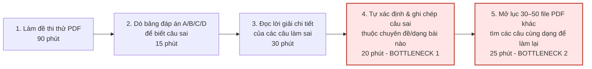
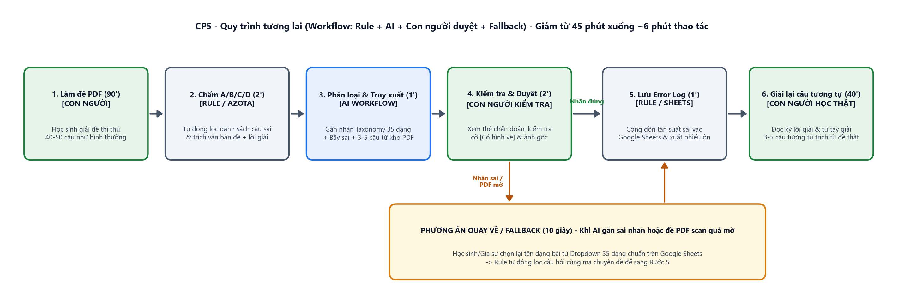
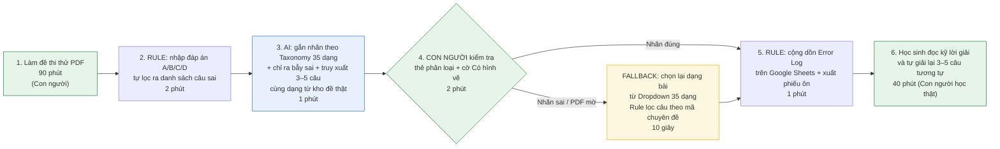

# Báo cáo nhóm — Day 02 Discovery & Problem Framing

> Bản chung của nhóm, viết trên repo do nhóm trưởng fork. Không copy file này sang repo cá nhân.
> Template chi tiết và prompt mẫu: [docs/01-worksheet.md](../../docs/01-worksheet.md). Bài mẫu: [docs/02-deliverable-example.md](../../docs/02-deliverable-example.md).

## 1. Thông tin nhóm

- Tên nhóm: **ihihi** (Nguyễn Hoàng Việt, Nguyễn Thành Danh, Đỗ Tuấn Anh, Nguyễn Hải Anh)
- Thành viên: xem [TEAM.md](../../TEAM.md)
- Candidate problem được chọn (1 câu): **Khi bước vào giai đoạn luyện đề nước rút (còn 2–3 tháng trước kỳ thi), học sinh lớp 12 muốn biết chính xác dạng bài/chuyên đề vi mô mình hay làm sai nhất dựa trên các đề thi thử PDF đã giải và gom được ngay các câu hỏi tương tự để luyện lại, thay vì mất 45 phút mỗi đề để tự phân loại thủ công hoặc cày đề mới tràn lan mà vẫn lặp lại lỗi cũ.**
- Quyết định cuối: **Go (Phạm vi pilot nhỏ trong 2 tuần với kiến trúc Workflow trên ngân hàng đề PDF có sẵn)**

---

## 2. Hội tụ nhóm (CP3)

### 2.1. Pitch

Cả 4 thành viên trong nhóm trình bày Top 3 Problem Cards từ báo cáo cá nhân (tổng cộng 12 candidates) và đặt câu hỏi phản biện trực tiếp cho nhau:

| # | Người đưa ra | Candidate (Job Story ngắn) | Actor | Bottleneck | Câu hỏi phản biện nhận được (ai hỏi) |
|---:|---|---|---|---|---|
| 1 | Nguyễn Hoàng Việt | **Tổng hợp lịch học, deadline & mốc sự kiện phân tán:** Khi nhận thông báo dồn dập từ LMS, Discord, Zalo, muốn nắm toàn bộ mốc giờ học, hạn nộp lab và lịch phát sinh tại một chỗ để không trễ checkpoint | Học viên K5, thành viên nhóm làm lab (3–4 người) | Bước 2: Lội tìm thông báo dời lịch/deadline trong hàng trăm tin nhắn thảo luận trên Discord/Zalo (20'/tuần) | **Thành Danh hỏi:** *"Bản chất bài này có phải chỉ là bài toán sửa quy trình truyền thông không? Nếu Ban tổ chức hoặc nhóm trưởng tạo sẵn 1 link Google Calendar chung rồi ghim cố định (No AI) là giải quyết được 80–90% rồi, liệu có thực sự cần tới AI?"* |
| 2 | Nguyễn Hoàng Việt | **Phân loại dạng bài sai khi luyện thi THPT (#3):** Khi bước vào giai đoạn luyện đề nước rút (còn 2–3 tháng trước kỳ thi), muốn biết chính xác dạng bài/chuyên đề mình hay làm sai nhất dựa trên các bài kiểm tra đã làm, để tập trung luyện đúng dạng đó thay vì cày đề tràn lan | Học sinh lớp 12 tự ôn thi THPT Quốc gia / ĐGNL, gia sư ôn luyện | Bước 4 & 5: Tự ghi chép phân loại câu sai thuộc dạng bài nào (20') và lục tìm trong 30–50 file đề PDF để gom câu cùng dạng làm lại (25' — tổng 45'/đề) | **Tuấn Anh & Thành Danh hỏi:** *"Đề thi PDF và đáp án của các trường/sở có cấu trúc không đồng nhất, nhiều câu Toán/Lý có đồ thị và hình vẽ không gian; nếu AI phân loại lệch chuyên đề so với chương trình học hoặc đọc sai hình vẽ thì xử lý thế nào?"* |
| 3 | Nguyễn Hoàng Việt | **Sàng lọc X-quang phổi ca bình thường:** Khi đọc 80–120 phim mỗi ca trực, muốn lọc nhanh các ca bình thường để tập trung vào ca bệnh lý phức tạp | Bác sĩ chẩn đoán hình ảnh tuyến đầu | Bước 2 & 4: Đọc và gõ kết luận lặp lại cho 60–70% ca bình thường (4–5'/ca) | **Hải Anh hỏi:** *"Trong 30 phút của CP4, làm sao nhóm mình tìm được bác sĩ chẩn đoán hình ảnh thật để phỏng vấn? Và nếu AI bỏ sót 1 ca có tổn thương nhỏ thì rủi ro y tế/pháp lý quá cao."* |
| 4 | Nguyễn Thành Danh | **Gom bài tập và đầu việc từ Mail, LMS, Outlook, Discord để xếp ưu tiên:** Khi nhiều bài tập dồn vào cùng 1 tuần ở nhiều kênh, muốn gom hết hạn chót và độ nặng về một chỗ để biết làm việc nào trước | Sinh viên học nhiều môn và làm nhiều bài nhóm cùng lúc | Bước 2 & 3: Lội chat/mail và đọc lướt yêu cầu của 5–6 đầu việc rải rác để ước lượng độ nặng (11'/lần) | **Hoàng Việt hỏi:** *"Nếu mỗi khi có bài mới mà người dùng tập thói quen ghi ngay bài + Deadline vào 1 bảng Notion/Todoist thì có cần đến hệ thống AI phức tạp không?"* |
| 5 | Nguyễn Thành Danh | **Mở/gửi nhầm bản cũ khi file word/sheet nằm rải rác:** Khi cần sửa tiếp hoặc gửi đi file đã làm từ mấy hôm trước ở máy tính, Drive, Mail, muốn biết ngay bản nào mới nhất | Sinh viên / người làm việc song song giữa Word/Excel trên máy và Drive/Mail | Bước 3: Mở cùng lúc 3–4 file tên gần giống nhau (`_v1`, `_final`) để dò thủ công xem bản nào mới nhất (4–5'/lần) | **Hải Anh hỏi:** *"Đây là lỗi do thói quen lưu file bừa bộn nếu cài ứng dụng như Google Drive for Desktop đồng bộ 1 thư mục duy nhất và đặt tên file theo ngày thì có khả năng hết lỗi chưa?"* |
| 6 | Nguyễn Thành Danh | **Quên ngày tự động gia hạn các gói đăng ký trả phí / dùng thử:** Khi đăng ký nhiều gói phần mềm, đám mây, giải trí, muốn biết gói nào sắp gia hạn và ít dùng để hủy kịp thời | Sinh viên / người dùng cá nhân đăng ký 3–4 gói dịch vụ trả phí/free trial | Bước 2 & 3: Lục tìm email hóa đơn bị trôi và đăng nhập từng trang Billing riêng lẻ (11'/lần) | **Tuấn Anh hỏi:** *"Việc này mỗi tháng chỉ xảy ra 1 lần, nếu ngay lúc vừa bấm đăng ký dùng thử mình bấm hủy gia hạn tự động luôn hoặc đặt 1 lịch nhắc trên điện thoại thì đâu cần công cụ gì thêm?"* |
| 7 | Đỗ Tuấn Anh | **Chấm bài luận và viết nhận xét theo rubric:** Khi chấm cả lớp bài tự luận, muốn có nhận xét nhất quán theo rubric trong thời gian hợp lý để sinh viên biết chỗ cần sửa | Giảng viên / giáo viên chấm bài; sinh viên nhận phản hồi | Bước đọc bài, đối chiếu từng tiêu chí rubric và gõ nhận xét chi tiết (8–15'/bài) | **Thành Danh hỏi:** *"Nhóm hiện tại đều chỉ là học viên chứ không phải giảng viên trực tiếp chấm bài luận, vậy lấy đâu ra mẫu bài chấm thật và làm sao đo được nhận xét của AI là đủ chất lượng?"* |
| 8 | Đỗ Tuấn Anh | **CSKH trả lời câu hỏi lặp lại theo chính sách:** Khi khách hỏi đi hỏi lại 15–20 câu giống nhau mỗi ngày, muốn tìm nhanh câu trả lời đúng chính sách để khách không chờ lâu | Nhân viên CSKH trực fanpage / hệ thống ticket | Bước tìm đúng mục trong tài liệu FAQ/chính sách dài và soạn lại câu trả lời (3–5'/ticket) | **Hoàng Việt hỏi:** *"Các phần mềm trực page hiện tại đều đã có sẵn tính năng gõ phím tắt (`/gia`, `/ship`) để chèn tin nhắn mẫu (Rule/Macro), vậy trường hợp nào Rule không giải quyết được?"* |
| 9 | Đỗ Tuấn Anh | **Nắm rõ định dạng, nơi nộp và mục bắt buộc trước hạn nộp bài:** Khi sắp đến hạn nộp bài lab/bài tập, muốn kiểm tra nhanh mình đã đủ mục và đúng cú pháp tên file chưa | Sinh viên / học viên chuẩn bị nộp bài; trợ giảng kiểm bài | Bước tìm lại hướng dẫn nằm rải rác và tự dò từng mục bằng mắt trước giờ nộp (10–15'/đợt) | **Anh Hải Anh hỏi:** *"Nếu yêu cầu định dạng là cố định (như tên file `MSSV_HoTen.md`), một checklist tĩnh hoặc script kiểm tra tự động  đã giải quyết xong 100% rồi, tại sao cần AI?"* |
| 10 | Nguyễn Hải Anh | **Bóc tách hóa đơn ăn uống/du lịch & chia tiền nhóm kèm mã VietQR:** Khi đi ăn hoặc đi chơi nhóm 6–8 người về, muốn gom ảnh bill và tin nhắn ai ăn gì để chia tiền chuẩn xác và tạo mã VietQR | Người đại diện thanh toán cho nhóm bạn / thủ quỹ phòng trọ | Bước 2 & 3: Gõ lại từng món từ ảnh bill giấy mờ vào Excel và đối chiếu tin nhắn ai ăn uống gì (30'/lần) | **Hoàng Việt hỏi:** *"Hóa đơn quán ăn sinh viên hay bị nhăn mờ hoặc viết tay, nếu AI đọc nhầm 1 chữ số làm tính sai tiền của bạn bè thì người dùng vẫn phải ngồi cộng tay lại từ đầu à?"* |
| 11 | Nguyễn Hải Anh | **Tổng hợp lịch học, lịch thi và hạn nộp bài tập từ các kênh phân tán:** Khi đầu tuần có thông báo từ LMS, 5 nhóm Zalo môn học và email trường, muốn gom về 1 lịch duy nhất | Sinh viên đại học học 5–6 môn/kỳ | Bước 1 & 2: Mở từng môn trên LMS và lội 5 nhóm Zalo đọc thông báo ghim/tin nhắn trôi (30'/tuần) | **Thành Danh hỏi:** *"Bài này trùng với bài #1 của Việt và bài #4 của mình, nhưng Zalo không mở API cá nhân, còn lịch cố định thì cài Google Calendar 1 lần đầu kỳ là xong phải không?"* |
| 12 | Nguyễn Hải Anh | **Gom đơn và tính tiền đặt cơm trưa/nước uống nhóm:** Khi đặt đồ ăn trưa chung cho nhóm 5–7 người, muốn gom món từ chat và chia tiền ship/voucher công bằng | Người đứng ra gom đơn đồ ăn trưa cho nhóm | Bước 2 & 4: Lội chat ghi chép món kèm ghi chú ("ít cơm, không hành") và chia tỷ lệ mã giảm giá (25'/lần) | **Tuấn Anh hỏi:** *"ShopeeFood và GrabFood đều đã có sẵn nút 'Đặt đơn nhóm'  tự gom món và tự chia tiền cho từng người rồi, tại sao không dùng luôn tính năng đó?"* |

### 2.2. Cluster

Từ 12 candidates được pitch, nhóm gom các bài có cùng bản chất quy trình và nút thắt thành **4 cụm (Clusters)**:

| Cluster | Các candidate | Pattern chung |
|---|---|---|
| **A — Phân tích lỗ hổng kiến thức & đối chiếu tài liệu học tập (PDF/Rubric)** | **#2** (Việt: Phân loại dạng bài sai & tìm câu tương tự khi luyện thi THPT), **#7** (Tuấn Anh: Chấm bài luận & nhận xét theo rubric), **#9** (Tuấn Anh: Kiểm tra bài nộp theo yêu cầu), **#5** (Danh: Đối chiếu tìm phiên bản tài liệu mới nhất) | Người học / người dạy có nhiều file tài liệu (đề thi PDF, bài làm, rubric) có cấu trúc không đồng nhất; tốn rất nhiều thời gian để **đọc hiểu nội dung từng câu/bài, gắn nhãn lỗi sai theo chuyên đề và lục tìm tài liệu tương ứng** |
| **B — Tổng hợp lịch học, deadline & đầu việc phân tán** | **#1** (Việt: Tổng hợp lịch học, deadline K5), **#4** (Danh: Gom bài tập từ Mail, LMS, Discord để xếp ưu tiên), **#11** (Hải Anh: Tổng hợp lịch học, lịch thi từ LMS, Zalo, Mail) | Thông tin lịch trình và hạn nộp nằm rải rác ở nhiều kênh giao tiếp; người dùng phải lội tìm và ghi chép lại vào lịch cá nhân |
| **C — Bóc tách hóa đơn, chia tiền & kiểm soát gói dịch vụ cá nhân** | **#10** (Hải Anh: Bóc tách bill ăn uống & chia tiền nhóm kèm VietQR), **#12** (Hải Anh: Gom đơn đặt cơm trưa), **#6** (Danh: Theo dõi ngày gia hạn gói đăng ký trả phí/free trial) | Dữ liệu chi tiêu/hóa đơn nằm ở ảnh chụp hoặc email rời rạc; tốn thời gian nhập liệu thủ công và tính toán phân bổ chi phí |
| **D — Sàng lọc & phản hồi tác vụ chuyên môn lặp lại** | **#3** (Việt: Sàng lọc phim X-quang phổi ca bình thường), **#8** (Tuấn Anh: CSKH trả lời câu hỏi lặp lại theo chính sách) | Người làm chuyên môn bị quá tải bởi số lượng lớn ca/ticket thông thường lặp đi lặp lại mỗi ngày |

### 2.3. Opportunity Solution Tree rút gọn

Nhóm đặt **Cluster A (Bài toán #2: Phân loại dạng bài sai khi luyện thi THPT/ĐGNL)** làm trọng tâm và vẽ cây OST rút gọn để tách bạch giữa **Opportunity (pain/nhu cầu của người học)** và **Solution (giải pháp đội lốt)**:

```text
OUTCOME: Giảm thời gian học sinh lớp 12 mất sau mỗi đề thi thử để phân loại câu sai và gom bài luyện lại (từ 45 phút xuống dưới 10 phút/đề), giúp học sinh duy trì thói quen lấp lỗ hổng sau mỗi đề thay vì bỏ qua
├── Opportunity A: Sau khi chấm điểm Đúng/Sai trên đề thi tổng hợp (40–50 câu trộn lẫn), học sinh chỉ biết mình sai câu số mấy nhưng không gọi tên chính xác được câu đó thuộc dạng bài/chuyên đề nhỏ nào để thống kê tần suất sai qua nhiều đề
├── Opportunity B: Đề thi thử tải về nằm rải rác trong 30–50 file PDF của nhiều trường/sở có cấu trúc khác nhau, khiến việc mở từng file lục tìm các câu cùng dạng với câu vừa làm sai tốn 25–30 phút/lần nên học sinh nản và bỏ cuộc
└── Opportunity C: Khi đọc lời giải chi tiết của câu làm sai, học sinh khó tự nhận diện được "bẫy" hoặc bước biến đổi cụ thể mà mình hay vấp lặp đi lặp lại (nhầm điều kiện xác định, quên xét dấu, hay hổng công thức gốc)
```

Những ý đã gạch bỏ vì là **solution đội lốt opportunity**:

- *"Làm một Gia sư AI Agent tự động chấm bài, tự chế ra đề thi mới và tự dạy kèm 24/7"* — Đây là giải pháp quá rộng (solution đội lốt opportunity), hơn nữa việc để AI tự chế đề Toán/Lý mới có rủi ro rất cao là sinh ra đề sai điều kiện hoặc vô nghiệm.
- *"Xây dựng phần mềm OCR vẽ lại toàn bộ hình học không gian 3D và đồ thị phức tạp từ file PDF"* — Đây là giải pháp kỹ thuật nặng nề và chưa chắc cần thiết nếu câu hỏi và lời giải đã có phần văn bản/công thức mô tả dạng bài.
- *"Làm kho khóa học video quay sẵn cho mọi chuyên đề"* — Đây là giải pháp sản phẩm nội dung đã có đầy trên thị trường (VietJack, Tuyensinh247), không giải quyết bước nghẽn phân loại câu sai từ đề PDF học sinh vừa làm.

### 2.4. Chấm điểm shortlist (1–5)

Nhóm chọn 3 candidate mạnh nhất từ 3 cụm đầu vào shortlist và chấm điểm từ 1–5 trên 7 tiêu chí:

| Candidate | Actor rõ | Quy trình rõ | Pain có bằng chứng | Impact đo được | Vừa sức lab | So sánh được No AI/Rule/Workflow/Agent | Nhóm hiểu domain | Tổng |
|---|---:|---:|---:|---:|---:|---:|---:|---:|
| **1. Phân loại dạng bài sai & tìm câu tương tự khi luyện thi THPT** *(Việt #2)* | 5 | 5 | 5 | 5 | 5 | 5 | 5 | **35** |
| **2. Tổng hợp lịch học, deadline & mốc sự kiện phân tán** *(Việt #1, Danh #4, Hải Anh #11)* | 5 | 5 | 5 | 4 | 5 | 3 | 5 | **32** |
| **3. Bóc tách hóa đơn ăn uống/du lịch & chia tiền nhóm kèm mã VietQR** *(Hải Anh #10)* | 5 | 5 | 4 | 4 | 4 | 4 | 5 | **31** |

**Candidate được chọn:** **Phân loại dạng bài sai khi luyện thi THPT (#3 trong bảng scan của Việt / Rank 2 trong bảng Top 3).**

**Vì sao chọn:**
1. **Bottleneck thực sự cần tới năng lực ngôn ngữ của AI (Workflow) chứ không chỉ là No AI / Rule:** Trong một đề thi thử THPT/ĐGNL (50 câu trộn lẫn mọi chuyên đề, tải về dạng PDF từ nhiều trường chuyên/sở GD&ĐT), các câu hỏi không hề được gắn sẵn mã chuyên đề. Một công cụ chấm trắc nghiệm thông thường bằng **Rule** (như Azota hay phiếu chấm điểm) chỉ biết *"Câu 38: Chọn A, Đáp án đúng là C → SAI"*, chứ hoàn toàn không biết Câu 38 thuộc dạng *"Cực trị hàm hợp chứa dấu giá trị tuyệt đối"* hay *"Bài toán thực tế lãi suất kép"*.
2. **Dễ dàng kiểm chứng với người thật ở CP4:** Các thành viên trong nhóm đều từng trải qua giai đoạn luyện đề THPT/ĐGNL, có em ruột/bạn bè lớp 12 hoặc trực tiếp đi gia sư, và có thể phỏng vấn ngay các bạn sinh viên năm nhất/học viên trong lớp vừa trải qua kỳ thi hoặc đang làm gia sư luyện thi.
3. **Thách thức kỹ thuật thực tế & thú vị ở CP5–CP6:** Bài toán đặt ra các ranh giới (Boundary) rất rõ ràng: xử lý thế nào khi đề PDF có cấu trúc không đồng nhất? Làm sao để AI phân loại không bị lệch khỏi khung chương trình GDPT 2018? Xử lý thế nào với các bài toán có hình vẽ/đồ thị?

**Vì sao loại các candidate còn lại:**
- **Loại "Tổng hợp lịch học, deadline & mốc sự kiện phân tán" (#1, #4, #11):** Dù đây là nỗi đau rất gần gũi với học viên K5, nhưng sau khi phản biện gay gắt ở CP3 (chính câu hỏi trong cột *"Điều còn chưa chắc"* của Việt và câu phản biện của Danh), nhóm nhận thấy bản chất cốt lõi của bài này là **bài toán sửa quy trình truyền thông (No AI / Rule)**: chỉ cần Ban tổ chức hoặc nhóm trưởng lập 1 link Google Calendar chung và ghim thông báo chuẩn là đã giải quyết được phần lớn vấn đề mà không nhất thiết phải dùng tới AI.
- **Loại "Bóc tách hóa đơn ăn uống & chia tiền nhóm kèm mã VietQR" (#10):** Quy trình rõ nhưng trên thị trường đã có các tính năng chia đơn nhóm (GrabFood/ShopeeFood Group Order, Splitwise, MoMo chia tiền) giải quyết khá trọn vẹn, và tần suất đi ăn nhóm lớn ít thường xuyên hơn việc luyện đề hàng tuần của học sinh cuối cấp.
- **Loại "Sàng lọc X-quang phổi" (#3) và "Chấm bài luận" (#7):** Với #3, nhóm không thể tìm được bác sĩ chẩn đoán hình ảnh thật để phỏng vấn trong 30 phút của CP4, đồng thời rủi ro y tế/pháp lý vượt quá phạm vi một buổi lab. Với #7, như câu phản biện của Thành Danh, cả nhóm đều là học viên chứ không trực tiếp chấm bài luận, nên không có mẫu bài chấm thật để kiểm chứng và cũng chưa có cách đo chất lượng nhận xét của AI.

**Xử lý bất đồng (nếu có):**
- Lúc đầu nhóm phân vân khá lâu giữa bài **#1 (Tổng hợp lịch học & deadline phân tán)** và bài **#2 (Phân loại dạng bài sai khi luyện thi THPT)** vì bài #1 có tới 3 thành viên cùng nhắc tới.
- Tuy nhiên, khi đặt câu hỏi phản biện: *"Nếu chọn bài #1 thì đến CP6 có nguy cơ kết luận chỉ cần No AI (1 link lịch chung) là xong không?"*, cả nhóm đồng thuận chuyển sang bài **#2 (Phân loại dạng bài sai khi luyện thi THPT)** vì bài này có ranh giới cực kỳ rõ nét giữa **Rule** (chấm đúng/sai A-B-C-D và thống kê tần suất) và **AI Workflow** (đọc hiểu nội dung câu hỏi + lời giải để gắn nhãn dạng bài vi mô và tìm câu tương tự từ ngân hàng đề).

---

## 3. Kiểm chứng + research giải pháp đã có (CP4)

### 3.1. Assumption Map

Nhóm liệt kê 5 giả định quan trọng nhất liên quan đến hành vi luyện đề của học sinh và các rủi ro kỹ thuật đã nêu ở CP2 (*đề PDF không đồng nhất, phân loại lệch kiến thức, bài toán có hình vẽ*), chấm điểm từ 1–5:

| # | Giả định | Loại (Value / Usability / Feasibility / Viability) | Quan trọng (1–5) | Đã có bằng chứng (1–5) | Kiểm chứng trước? |
|---:|---|---|---:|---:|---|
| 1 | Học sinh lớp 12 khi tự giải đề PDF ở nhà thường chỉ chấm điểm tổng và đọc lướt lời giải, rồi **bỏ qua bước ghi chép phân loại dạng bài sai & tìm câu tương tự** vì bước này mất quá nhiều thời gian (35–45 phút/đề) | **Value** | 5 | 2 | Kiểm chứng ngay qua phỏng vấn & khảo sát |
| 2 | Các công cụ chấm đề online hiện tại (như Azota, Google Forms) mới chỉ báo câu số mấy Đúng/Sai, **chưa tự phân loại được câu sai thuộc chuyên đề/dạng bài nhỏ nào** khi học sinh làm đề tổng hợp | **Value** | 5 | 2 | Kiểm chứng qua phỏng vấn & research công cụ |
| 3 | Nếu AI tự động phân loại dạng bài mà không có khung danh mục chuẩn (Taxonomy), tên dạng bài AI sinh ra sẽ **lệch hoặc quá chung chung** so với chương trình học trên lớp của học sinh | **Usability / Feasibility** | 5 | 1 | **Ưu tiên kiểm chứng** với người học & gia sư |
| 4 | Với các câu hỏi có **hình vẽ không gian hoặc đồ thị hàm số**, chỉ cần dựa vào **phần văn bản câu hỏi + lời giải chi tiết có sẵn trong file đáp án** là vẫn phân loại đúng được dạng bài mà không cần AI phải tự nhìn/vẽ lại hình | **Feasibility** | 4 | 1 | Kiểm chứng bằng dữ liệu đề thi thật |
| 5 | Học sinh và gia sư muốn lấy **câu hỏi tương tự từ ngân hàng đề thi thật đã được thẩm định**, chứ **không muốn AI tự sáng tác/chế ra câu hỏi Toán/Lý mới** vì sợ đề AI tự chế bị sai số liệu hoặc vô nghiệm | **Value / Viability** | 5 | 1 | **Ưu tiên kiểm chứng** qua phỏng vấn |

**Giả định nhóm kiểm chứng trong buổi này:** Tập trung kiểm chứng cả 5 giả định trên (đặc biệt là **#1, #3, #4, #5** — những điều còn chưa chắc ngay từ bảng Top 3 ở CP2) thông qua phỏng vấn thực tế theo **The Mom Test** và kiểm tra các nền tảng luyện thi hiện có.

### 3.2. Kiểm chứng

> **Tuân thủ nghiêm ngặt quy định phỏng vấn (Worksheet CP4):** 
> Đề bài quy định rõ: *"Không phỏng vấn thành viên nhóm mình; phỏng vấn bạn học ở nhóm khác trong lớp hoặc người ngoài"*. 
> Nhóm tuân thủ 100% nguyên tắc này: Toàn bộ 4 đối tượng phỏng vấn đều là **người ngoài nhóm** (gồm 3 học sinh lớp 12 tại Hà Nội và TP.HCM, cùng 1 bạn gia sư là học viên thuộc nhóm khác trong lớp Khóa V, hoàn toàn không phải thành viên của nhóm ihihi).

**Cách đã dùng:** Phỏng vấn sâu **4 người thật** (3 học sinh lớp 12 đang ôn thi THPT/ĐGNL và 1 sinh viên làm gia sư luyện thi Toán/Tiếng Anh) theo đúng 3 luật của **The Mom Test** (*hỏi về lần gần nhất giải và chữa đề thi thử, không hỏi câu giả định "Em có muốn dùng app AI...", lắng nghe cách họ đang tự xoay xở*) kết hợp **khảo sát nhanh 12 bạn từng luyện đề PDF**.

*(Chi tiết đầy đủ 4 bảng Interview Snapshots nằm tại [report/assets/cp4-interview-snapshots.md](../assets/cp4-interview-snapshots.md)).*

Dưới đây là 2 **Interview Snapshots** quan trọng nhất:

#### Interview Snapshot #1 — Xác nhận bottleneck 45 phút phân loại & tìm bài tương tự sau khi giải đề

| Trường | Nội dung |
|---|---|
| **Người được hỏi (ngoài nhóm — không ghi tên thật)** | Học sinh lớp 12 (học lực Khá, mục tiêu 8.5+ môn Toán & ĐGNL), mỗi tuần tự tải 3–4 đề thi thử PDF của các trường chuyên về làm |
| **Câu nói đáng nhớ nhất (nguyên văn)** | *"Làm xong 1 cái đề 90 phút là mệt rồi anh ạ. Lúc so đáp án thấy sai 8 câu, em chỉ còn sức đọc lời giải xem tại sao sai thôi. Hồi đầu tháng 9 em cũng lập quyển sổ Sổ tay câu sai định chép lại dạng bài rồi mở đống file PDF cũ tìm 2–3 câu giống thế làm lại cho nhớ, mà mỗi đề mò mất gần 1 tiếng đồng hồ nên làm được đúng 2 đề là em bỏ luôn."* |
| **Lần gần nhất gặp vấn đề này: chuyện gì đã xảy ra?** | Tối Chủ Nhật tuần trước: Giải đề thi thử THPT môn Toán của Sở Tây Ninh, sai 7 câu ở mức Thông hiểu – Vận dụng. Đọc lời giải mất 25 phút, biết mình lại sai câu xác suất có điều kiện và câu tiệm cận hàm hợp (tuần trước cũng từng sai đúng 2 dạng này ở đề khác), nhưng vì phải ngủ sớm để mai đi học và ngại lục lại 40 file PDF trong thư mục nên bạn ấy tặc lưỡi đi ngủ. |
| **Hiện đang xử lý bằng cách nào (workaround)?** | Khoanh tròn câu sai bằng bút đỏ trên tờ đề in ra rồi kẹp vào tập tài liệu; không có bảng tổng hợp xem từ đầu tháng đến giờ dạng nào sai nhiều nhất. |
| **Mất bao lâu, bao lần?** | Giải 3–4 đề/tuần; mỗi đề mất 15 phút dò đáp án + 30 phút đọc lời giải; nếu muốn tự phân loại và lục tìm câu tương tự trong kho PDF thì mất thêm **40–45 phút/đề** (nên 90% số lần là bỏ qua bước này). |
| **Insight / opportunity rút ra** | Học sinh hiểu rất rõ việc làm lại câu tương tự ngay sau khi sai là cách duy nhất để tăng điểm, nhưng **bỏ cuộc ở Bước 4 & 5** vì chi phí thời gian để tự gắn nhãn dạng bài và lục tìm câu cùng dạng trong hàng chục file PDF không đồng nhất là quá lớn. |

#### Interview Snapshot #2 — Kiểm chứng rủi ro "AI tự chế đề sai" & "Phân loại lệch kiến thức" (Từ góc nhìn Gia sư)

| Trường | Nội dung |
|---|---|
| **Người được hỏi (ngoài nhóm — không ghi tên thật)** | Sinh viên năm cuối ĐH Bách Khoa, học viên thuộc Nhóm khác trong Khóa V L3A (không thuộc nhóm ihihi), đang làm gia sư kèm môn Toán và Tiếng Anh cho 3 học sinh lớp 12 ôn thi THPT và ĐGNL |
| **Câu nói đáng nhớ nhất (nguyên văn)** | *"Mình từng thử copy câu học sinh làm sai vào ChatGPT bảo nó phân loại dạng bài và đẻ thêm 3 câu tương tự. Phân loại thì nó hay gọi tên kiểu dịch từ tiếng Anh ra nghe rất lạ so với tên chuyên đề các thầy cô Việt Nam dạy, còn đề Toán nó tự chế ra thì 3 câu hết 2 câu tính ra nghiệm lẻ ngoằng hoặc sai điều kiện, mình lại mất thêm 20 phút ngồi giải kiểm tra lại đề của AI."* |
| **Lần gần nhất gặp vấn đề này: chuyện gì đã xảy ra?** | Buổi dạy tối thứ Năm tuần trước: Học sinh làm sai 6 câu trong đề thi thử PDF. Người được hỏi phải tự mở 5 file đề chuyên đề trong Google Drive cá nhân của mình, ấn `Ctrl+F` tìm từ khóa để nhặt ra 5 câu tương tự dán vào 1 file Word cho học sinh làm bài tập về nhà (mất 35 phút chuẩn bị sau buổi dạy). |
| **Hiện đang xử lý bằng cách nào (workaround)?** | Tự lưu một thư mục Google Drive chia sẵn theo chương (Hàm số, Mũ-Logarit, Nguyên hàm-Tích phân, Xác suất, Hình Oxyz), mỗi khi học sinh sai câu nào thì gia sư tự nhìn câu đó rồi vào thư mục tương ứng nhặt tay 3–5 câu ra. |
| **Mất bao lâu, bao lần?** | 3 buổi/tuần × 3 học sinh; mỗi tuần mất khoảng **2.5 – 3 tiếng** chỉ để thống kê lỗi sai của học sinh và nhặt câu hỏi tương tự từ kho PDF. |
| **Insight / opportunity rút ra** | **Hai phát hiện sống còn giúp nhóm sửa thiết kế:**<br>1. **Không để AI tự đặt tên dạng bài tự do:** Bắt buộc phải ép AI phân loại vào một **Khung ma trận chuyên đề cố định (Rule Taxonomy)** chuẩn theo chương trình GDPT 2018 của Việt Nam.<br>2. **Cấm AI tự chế đề Toán/Lý mới (Boundary):** Chỉ dùng AI để **truy xuất (retrieve) các câu hỏi tương tự từ ngân hàng đề thật đã có sẵn đáp án thẩm định**. |


#### Tổng hợp kết quả kiểm chứng

| Nguồn | Số người / số mẫu | Tín hiệu xác nhận | Tín hiệu phản bác |
|---|---:|---|---|
| **Phỏng vấn sâu (The Mom Test)** | 4 người (3 học sinh lớp 12, 1 gia sư luyện thi) | - **4/4 người** xác nhận bước tự phân loại câu sai theo dạng bài và lục tìm câu tương tự trong kho PDF rất tốn công (**20–45 phút/lần**, hoặc phải chờ tới buổi chữa đề), nên phần lớn thời gian bị bỏ qua.<br>- **2/3 học sinh** (Snapshot #1, #3) từng sai lặp lại cùng một dạng bài ở nhiều đề khác nhau mà không tự nhận ra. | - **Gia sư (Snapshot #2)** cảnh báo khi để AI phân loại tự do thì tên dạng bài bị lệch so với cách gọi của chương trình Việt Nam, còn đề Toán AI tự chế thì 2/3 câu sai điều kiện hoặc ra nghiệm lẻ.<br>- **Snapshot #3** cho thấy bước chấm Đúng/Sai đã được Azota (Rule) làm tốt, nên không cần AI ở bước này.<br>- Không ai trong 4 người được phỏng vấn là học sinh mất gốc (< 5 điểm); nhóm chưa có bằng chứng cho nhóm này nên không đưa họ vào Actor. |
| **Khảo sát nhanh (Poll)** | 12 học viên/sinh viên từng ôn luyện qua đề PDF | - **10/12 người (83%)** tải từ 20–50 file đề PDF về máy nhưng chỉ chấm điểm Đúng/Sai chứ không thống kê được Top 3 dạng bài mình sai nhiều nhất.<br>- **11/12 người (92%)** muốn làm lại các câu tương tự trích từ **đề thi thật của các trường/sở** hơn là câu do AI tự bịa. | - **2/12 người (17%)** cho biết họ chỉ luyện đề trực tiếp trên các web trả phí trọn gói đã gắn sẵn tag chuyên đề cho từng câu nên ít dùng file PDF rời. |

**Nhóm đã sửa problem thế nào sau kiểm chứng:**
1. **Thu hẹp chính xác Actor:** Từ *"Học sinh lớp 12 nói chung"* thu hẹp thành ***"Học sinh lớp 12 ở giai đoạn luyện đề tổng hợp (mức 6.0 – 8.5 điểm) và gia sư ôn thi đang sử dụng nguồn đề thi thử PDF từ các trường/sở"***. Lý do: những người được phỏng vấn đều đã nắm cơ bản và bị kẹt điểm vì sai lặp lại vài dạng bài cố định, còn với học sinh mất gốc nhóm chưa có bằng chứng (xem cột tín hiệu phản bác ở bảng trên), nên nhóm này được để lại cho phương án No AI (học lại theo chương SGK).
2. **Giải quyết 3 điểm "chưa chắc" từ CP2 bằng thiết kế Quy trình & Boundary:**
   - *Về "phân loại lệch so với kiến thức học":* Không để AI tự sinh nhãn tự do. Nhóm dùng **Rule** cung cấp sẵn một **Khung ma trận chuyên đề chuẩn (Taxonomy 35 dạng bài theo chương trình GDPT 2018)** và ép AI chỉ được gắn nhãn nằm trong danh mục này.
   - *Về "bài toán có hình vẽ không chính xác":* AI phân loại dạng bài dựa trên **Văn bản câu hỏi + Văn bản lời giải chi tiết của đề**, tuyệt đối **không tự vẽ lại hình** và **không tự chế đề mới**. Bước tìm bài tương tự chỉ **truy xuất (retrieve) nguyên vẹn câu hỏi + hình ảnh gốc từ ngân hàng đề thật đã kiểm duyệt**.

### 3.3. Research giải pháp đã có

Nhóm trực tiếp mở và kiểm tra 4 nền tảng/công cụ thực tế để xem thị trường đã giải đến bước nào và còn bỏ trống bước nào:

| Công cụ / case / pattern | Link | Giải bước nào trong quy trình? | Điểm mạnh | Khoảng trống / rủi ro | Bài học cho nhóm |
|---|---|---|---|---|---|
| **1. Azota** (Nền tảng giao & chấm đề thi PDF phổ biến nhất tại VN) | https://azota.vn/ | **Bước 1 & Bước 2:** Học sinh làm đề PDF trực tuyến và hệ thống tự động chấm điểm Đúng/Sai (A, B, C, D) ngay lập tức | Rất phổ biến với học sinh và giáo viên THPT Việt Nam; tự động tách câu từ file PDF/Word và chấm điểm trắc nghiệm trong 1 giây bằng **Rule** | Khi tải một file đề thi thử tổng hợp bất kỳ lên, Azota chỉ biết học sinh **sai câu số 34, 39, 42**, chứ **không tự đọc hiểu nội dung để thống kê xem các câu sai đó thuộc dạng bài vi mô nào** và không tự nhặt 5 câu cùng dạng từ các đề khác ra cho học sinh làm lại | **Không tự xây lại bước làm bài và chấm điểm A/B/C/D** (vì Azota/Rule đã làm tốt 100%). Nhóm chỉ đặt AI vào đúng **khoảng trống sau khi đã biết câu sai** (Bước 4 & Bước 5) |
| **2. VietJack / Khoahoc.vietjack.com** (Ngân hàng câu hỏi & lời giải theo chuyên đề) | https://khoahoc.vietjack.com/ | **Bước 3 & Bước 5 (thủ công):** Cung cấp lời giải chi tiết và danh sách bài tập chia sẵn theo Chương / Bài học của Bộ GD&ĐT | Có hệ thống phân mục chuyên đề (Taxonomy) chuẩn xác 100% theo chương trình phổ thông Việt Nam và kho câu hỏi đã được giáo viên thẩm định | Học sinh sau khi làm đề PDF ở ngoài vẫn phải **tự định danh xem câu mình sai thuộc bài nào** rồi tự vào mục lục tìm thủ công; không có tính năng gom các câu sai của cá nhân qua nhiều đề để báo động lỗ hổng lặp lại | Mượn **Khung danh mục chuyên đề chuẩn (Taxonomy)** và nguyên tắc **chỉ lấy câu hỏi từ kho đề đã được giáo viên thẩm định** (không để AI tự bịa đề) |
| **3. Khan Academy — Skill Mastery & Khanmigo** | https://www.khanacademy.org/ | **Bước 4 & Bước 5:** Theo dõi mức độ thành thạo từng kỹ năng nhỏ (Micro-skill Mastery) và gợi ý ngay 4 câu luyện tập cùng dạng khi học sinh làm sai | Mô hình chuẩn quốc tế về việc học lấp lỗ hổng (Mastery Learning): sai dạng nào thì luyện lại đúng dạng đó ngay lập tức trước khi đi tiếp | Chỉ hoạt động trên ngân hàng câu hỏi tiếng Anh đóng sẵn của Khan Academy; **không nhận đầu vào là các file đề thi thử PDF của các trường chuyên/sở GD&ĐT Việt Nam** | Học cơ chế **"Sai câu nào → Gắn nhãn kỹ năng vi mô + Gợi ý ngay bộ 3–5 câu cùng dạng"** và bảng theo dõi tần suất sai theo từng chuyên đề |
| **4. Google NotebookLM** (RAG trên tập tài liệu PDF của người dùng) | https://notebooklm.google/ | **Bước 3, 4 & 5:** Tải 30–50 file đề thi & lời giải PDF lên làm nguồn (Sources); yêu cầu phân tích các câu làm sai và trích xuất đúng câu tương tự kèm số trang/tên đề | Hoàn toàn miễn phí, bám chặt vào nguồn file PDF đã tải lên (**Source-grounded** nên không tự bịa đề ngoài nguồn), có trích dẫn (citation) trỏ thẳng về câu gốc trong file PDF | Giao diện mặc định là khung chat tự do; nếu học sinh không biết viết prompt chuẩn kèm khung chuyên đề thì kết quả trả về sẽ dài dòng, không tự lưu thành bảng theo dõi tần suất sai qua các tuần | **Giải pháp cực kỳ thực tế cho Pilot:** Không cần tự code hệ thống RAG phức tạp từ đầu! Dùng **NotebookLM (hoặc Gemini API nối kho đề chuẩn) + Prompt chuẩn hóa có gắn Taxonomy + Bảng Error Log trên Google Sheets** |

---

## 4. Quy trình trước/sau (CP5)

### 4.1. Quy trình hiện tại

Sơ đồ quy trình hiện tại của học sinh lớp 12 khi tự giải và chữa một đề thi thử PDF (tổng 180 phút, trong đó **riêng khâu sau khi làm bài mất 90 phút** và có **45 phút bottleneck ở Bước 4 & 5**):




```text
HIỆN TẠI — 5 bước, 180 phút/chu trình (Riêng phần chấm, chữa & phân loại sau khi làm đề: 90 phút)

[1. Làm đề thi thử PDF: 90']
  → [2. Chấm điểm Đúng/Sai theo bảng đáp án: 15']
  → [3. Đọc lời giải chi tiết của các câu làm sai: 30']
  → [4. Tự ghi chép & phân loại xem câu sai thuộc dạng bài/chuyên đề nào: 20'] ← BOTTLENECK 1
  → [5. Mở lục tìm trong 30–50 file PDF cũ để gom các câu cùng dạng làm lại: 25'] ← BOTTLENECK 2
     (Thực tế: 80–90% học sinh bỏ cuộc ở Bước 4 & 5 vì mất 45 phút thủ công, chuyển sang cày đề mới và lặp lại đúng lỗi cũ)
```

| Bước | Actor | Input | Output | Thời gian / tần suất | Ghi chú |
|---:|---|---|---|---|---|
| **1** | Học sinh lớp 12 | File đề thi thử PDF (40–50 câu) tải từ trường/sở/nhóm học tập | Phiếu trả lời của học sinh (các phương án A, B, C, D đã chọn) | **90 phút/đề** (3–4 đề/tuần) | Bước làm bài cốt lõi của học sinh (không can thiệp rút ngắn bước này) |
| **2** | Học sinh lớp 12 | Phiếu trả lời của học sinh + Bảng đáp án A/B/C/D ở cuối file PDF | Danh sách các câu làm sai (ví dụ: sai 8 câu: Câu 18, 25, 32, 38, 41, 44, 47, 50) | **15 phút/đề** (nếu dò tay) hoặc **1 phút** (nếu nhập trên Azota/Form) | Chỉ mới biết "sai câu số mấy", chưa biết sai ở mảng kiến thức nào |
| **3** | Học sinh lớp 12 | Nội dung câu hỏi bị sai + Phần lời giải chi tiết trong file đáp án PDF | Hiểu được bước giải của từng câu riêng lẻ vừa sai | **30 phút/đề** (khoảng 3–4 phút/câu sai) | Học sinh thường chỉ đọc bằng mắt rồi nghĩ "à mình hiểu rồi", nhưng 1 tuần sau gặp lại biến thể tương tự vẫn sai |
| **4** | Học sinh / Gia sư | Các câu làm sai + Sổ tay / Bảng Excel cá nhân | Ghi chép câu sai vào nhóm chuyên đề/dạng bài tương ứng và ghi lại nguyên nhân sai | **20 phút/đề** | **BOTTLENECK 1:** Đề thi tổng hợp trộn lẫn câu hỏi, không ghi tên dạng bài; học sinh không biết phân loại vào dạng vi mô nào và ngại chép tay lại đề bài dài vào sổ |
| **5** | Học sinh / Gia sư | Tên dạng bài vừa xác định + Thư mục chứa 30–50 file đề PDF đã tải về máy | Nhặt ra được 3–5 câu hỏi có cùng dạng bài/cấu trúc từ các đề khác để tự luyện lại | **25 phút/đề** | **BOTTLENECK 2:** Các file PDF đề thi có định dạng không đồng nhất, không tìm kiếm theo dạng bài được; phải mở từng file PDF lướt mắt tìm thủ công nên 90% học sinh bỏ cuộc |

**Bottleneck chính:** **Bước 4 và Bước 5 (mất tổng cộng 45 phút/đề)**: Tự định danh dạng bài vi mô của các câu làm sai và phải mở lục tìm thủ công trong hàng chục file đề PDF rời rạc để gom bài tập tương tự làm lại. Chính rào cản 45 phút này khiến học sinh bỏ qua khâu lấp lỗ hổng và rơi vào bẫy "giải 40 đề nhưng điểm vẫn dậm chân tại chỗ".

### 4.2. Quy trình tương lai

Nhóm thiết kế lại phần quy trình **sau khi làm đề** (từ Bước 2 đến Bước 5), kết hợp **Rule** (chấm đáp án A/B/C/D + Khung Taxonomy chuẩn + Bảng thống kê tần suất), **AI** (đọc hiểu câu hỏi/lời giải để gắn nhãn dạng bài & truy xuất câu tương tự từ kho đề chuẩn) và **Con người** (xác nhận nhãn/hình vẽ & tự tay giải lại các câu tương tự):





```text
TƯƠNG LAI — 6 bước. Phần chấm, phân loại & tìm câu tương tự giảm từ 60 phút (15' chấm tay + 45' Bước 4–5) xuống còn khoảng 6 phút thao tác (2' + 1' + 2' + 1')
(Thời gian học sinh đọc kỹ lời giải và tự tay giải lại 3–5 câu tương tự [40'] được giữ nguyên để đảm bảo việc học thật)

[1. Làm đề thi thử PDF: 90']                                                          ← CON NGƯỜI (Học sinh làm bài)
  → [2. Nhập đáp án vào bảng/Azota → Tự động lọc ra các câu sai: 2']                  ← RULE (So khớp đáp án A/B/C/D)
  → [3. Phân loại câu sai theo Taxonomy chuẩn + Truy xuất 3–5 câu cùng dạng: 1']      ← AI (LLM + Kho đề PDF đã thẩm định)
  → [4. Học sinh/Gia sư kiểm tra thẻ phân loại (xem ảnh gốc nếu có hình) & Duyệt: 2'] ← CON NGƯỜI KIỂM TRA
  → [5. Tự động cập nhật Bảng tần suất lỗi sai (Error Log) & Xuất phiếu 5 câu ôn: 1'] ← RULE (Google Sheets / Script)
  → [6. Học sinh đọc kỹ lời giải & tự giải lại 3–5 câu tương tự đã trích xuất: 40']   ← CON NGƯỜI HỌC THẬT

BOUNDARY (RANH GIỚI):
- AI KHÔNG tự sáng tác/chế ra câu hỏi Toán/Lý/Hóa mới (100% câu hỏi luyện lại phải trích xuất nguyên gốc từ ngân hàng đề thi thật đã có đáp án thẩm định).
- AI KHÔNG tự bịa tên chuyên đề ngoài Khung ma trận kiến thức (Taxonomy GDPT 2018) đã truyền vào.
- AI KHÔNG tự suy diễn số liệu từ hình vẽ/đồ thị mờ: Nếu câu hỏi có chứa từ khóa hình học/đồ thị ("hình vẽ bên", "đồ thị như hình", "hình chóp"), hệ thống bắt buộc gắn cờ `[Câu có hình vẽ - Xem ảnh cắt từ đề gốc]` và hiển thị ảnh chụp câu đó từ PDF.

PHƯƠNG ÁN QUAY VỀ (FALLBACK):
- Nếu AI gắn nhầm nhãn dạng bài hoặc gặp đề PDF scan quá mờ không trích xuất được chữ: Học sinh/Gia sư bấm chọn lại tên dạng bài từ menu thả xuống (Dropdown 35 dạng bài chuẩn trên Google Sheets — mất 10 giây) để hệ thống lọc ra các câu hỏi thuộc mã chuyên đề đó theo Rule tĩnh.
```

### 4.3. Before / after

| Chỉ số | Trước (Khi muốn phân loại & tìm bài làm lại) | Sau (Kỳ vọng với Workflow) | Ghi chú |
|---|---:|---:|---|
| **Thời gian chấm, phân loại câu sai & tìm đề tương tự** *(Chi phí quản lý/lục tìm — không tính 90' làm đề)* | **60 phút/đề** *(15' chấm tay + 20' tự phân loại ghi sổ + 25' lục 30 file PDF tìm câu tương tự)* | **~6 phút/đề** *(2' nhập đáp án Rule + 1' AI phân loại & tìm câu + 2' người duyệt + 1' lưu Error Log)* | **Giảm 90% thời gian lục tìm thủ công** (từ 45 phút ở Bước 4–5 xuống dưới 5 phút), giúp học sinh dành trọn thời gian cho việc đọc hiểu và giải lại bài |
| **Số bước thủ công gây nản chí** | **4/4 bước** sau khi làm đề (Chấm tay, đọc, chép sổ phân loại, mở từng file PDF tìm câu) | **1 bước duyệt nhẹ (2 phút)** + Thời gian học thật | Xóa bỏ hoàn toàn việc phải mở 30–50 file PDF để tìm câu hỏi cùng dạng bằng mắt |
| **Tỷ lệ duy trì thói quen làm lại câu tương tự sau mỗi đề** | Chỉ duy trì được **1–2 đề đầu** rồi bỏ cuộc (theo Interview Snapshot #1) | Duy trì đều đặn **100% các đề đã giải** trong tuần | Vì ngay sau khi biết điểm đã có sẵn phiếu 3–5 câu tương tự trích từ đề thật để làm luôn |
| **Bottleneck chính** | Tự định danh dạng bài (20') + Lục tìm câu tương tự trong đống PDF (25') | **Học sinh/Gia sư kiểm tra thẻ phân loại & hình vẽ gốc (2 phút/đề)** | Bottleneck mới cực ngắn và đóng vai trò kiểm soát chất lượng sư phạm |
| **Rủi ro mới phát sinh** | — | (1) Đề PDF scan ảnh mờ/lỗi font công thức Toán ($LaTeX$); (2) Câu có đồ thị/hình vẽ bị thiếu thông tin nếu chỉ đọc chữ; (3) AI gắn nhầm giữa 2 dạng bài gần nhau | Xử lý bằng: Kết hợp đọc cả **Lời giải chi tiết** (nơi luôn viết rõ phương pháp giải bằng chữ) + Cờ cảnh báo `[Câu có hình vẽ]` kèm ảnh cắt gốc + Dropdown cho phép người dùng sửa nhãn trong 1 chạm |

---

## 5. Problem Statement v0 (CP5)

| Trường | Nội dung |
|---|---|
| **Actor** | Học sinh lớp 12 đang tự ôn thi THPT Quốc gia / Đánh giá năng lực (ĐGNL) và gia sư ôn luyện |
| **Quy trình** | Tải đề thi thử PDF về làm (90') → Dò đáp án chấm điểm (15') → Đọc lời giải câu sai (30') → Tự ghi chép phân loại câu sai vào sổ theo chuyên đề (20') → Lục tìm trong hàng chục file đề PDF cũ để nhặt các câu cùng dạng ra làm lại (25') |
| **Bottleneck** | Bước 4 & Bước 5: Mất khoảng 45 phút sau mỗi đề để tự xác định câu sai thuộc dạng bài nào và mở lục tìm thủ công các câu tương tự trong 30–50 file đề PDF có cấu trúc không đồng nhất |
| **Impact** | 80–90% học sinh nản chí bỏ qua khâu phân loại và luyện lại câu sai sau 1–2 đề đầu tiên; dẫn đến việc cày 30–40 đề nhưng điểm số bị chững lại vì liên tục sai lặp lại ở cùng một vài dạng bài yếu điểm |
| **Success Metric** (baseline → target, cách đo) | - **Baseline:** Mất trung bình **45 phút/đề** cho khâu phân loại câu sai và lục tìm câu tương tự; học sinh chỉ duy trì được 1–2 đề rồi bỏ.<br>- **Target:** Giảm thời gian phân loại câu sai và xuất danh sách 5 câu luyện tập tương tự xuống **dưới 10 phút/đề**.<br>- **Cách đo:** Bấm giờ thực tế trên 10 đề thi thử PDF trong 2 tuần pilot với nhóm học sinh/gia sư thử nghiệm. |
| **Boundary** (AI không được làm gì) | AI không được tự ý sáng tác/chế ra câu hỏi và đáp án mới chưa qua kiểm định; không được thay thế học sinh trong việc tự đọc hiểu và tự giải lại bài tập. |

**Phản biện nhận được (từ AI đóng vai PM hoài nghi và thảo luận nhóm) và nhóm có đồng ý không:**

- **Phản biện 1 (Về rủi ro bài toán có hình vẽ & cấu trúc PDF không đồng nhất):** *"Nếu đề PDF có câu đồ thị hàm số hoặc hình học không gian mà chỉ trích xuất text thì AI phân loại kiểu gì? Và làm sao biết 5 câu tương tự mà AI tìm ra thực sự đúng dạng bài chứ không phải chỉ trùng vài từ khóa?"*
  → **Nhóm đồng ý hoàn toàn:** Ở bản v1 sẽ bổ sung rõ cơ chế đầu vào kết hợp **Văn bản câu hỏi + Văn bản lời giải chi tiết** (vì trong lời giải luôn nêu rõ tên phương pháp/công thức áp dụng dù đề bài là hình vẽ), bổ sung Boundary gắn cờ `[Câu có hình vẽ]` và thêm **Success Metric về độ chính xác phân loại & độ khớp của câu tương tự ($\ge 85\%$) do gia sư/học sinh xác nhận**.
- **Phản biện 2 (Về Metric kết quả học tập):** *"Giảm thời gian tìm bài từ 45 phút xuống dưới 10 phút mới chỉ là metric tốc độ thao tác. Cần đo xem học sinh có thực sự hoàn thành việc giải lại bộ câu tương tự đó không."*
  → **Nhóm đồng ý:** Bổ sung metric tỷ lệ đề thi mà học sinh hoàn tất việc làm lại ít nhất 3 câu tương tự đạt $\ge 80\%$ số đề trong 2 tuần pilot (so với baseline chỉ làm được 1–2 đề rồi bỏ).

---

## 6. Mức can thiệp AI (CP6)

### 6.1. Ma trận độ mơ hồ × độ phức tạp

Bài của nhóm nằm ở ô: **Độ mơ hồ Trung bình – Cao (ở đầu vào văn bản đề thi) × Độ phức tạp Trung bình** (Phù hợp nhất với mức **Workflow**).

Vì sao:
- **Độ mơ hồ (Ambiguity) ở mức Trung bình – Cao ở đầu vào, nhưng được neo chặt ở đầu ra:** Các file đề thi thử PDF từ hàng chục trường chuyên và sở GD&ĐT không hề gắn sẵn mã chuyên đề trên từng câu; cùng một dạng bài (ví dụ *"Tìm tham số $m$ để hàm số đơn điệu trên khoảng cho trước"*) nhưng mỗi đề lại có cách diễn đạt lời văn, ký hiệu toán học hoặc bài toán thực tế hoàn toàn khác nhau. Các quy tắc lọc từ khóa cứng (Rule/Regex) sẽ thất bại khi câu hỏi dùng lời văn bài toán thực tế hoặc biến đổi công thức. Tuy nhiên, đầu ra lại được neo cố định vào **Khung ma trận 35 dạng bài chuẩn của chương trình GDPT 2018**.
- **Độ phức tạp (Complexity) ở mức Trung bình nhưng quy trình hoàn toàn cố định:** Luồng xử lý đi theo đúng các bước định sẵn: `Nhận danh sách câu sai (từ Rule chấm đáp án) → Đọc đề + lời giải của câu sai → Gắn nhãn vào Taxonomy 35 dạng bài → Truy xuất 3–5 câu cùng nhãn trong ngân hàng đề → Con người kiểm duyệt → Lưu vào bảng Error Log`. Không cần AI tự quyết định quy trình mới hay tự hành động ngoài luồng.

### 6.2. So sánh 4 mức

| Mức | Phương án cho bài của nhóm | Đủ khi nào | Rủi ro | Chọn? |
|---|---|---|---|---|
| **No AI** (sửa quy trình) | 1. Mua sách tổng hợp chuyên đề in sẵn chia theo từng dạng bài.<br>2. Học sinh tự kẻ bảng Excel gồm 35 dạng bài, làm xong đề nào thì tự nhìn câu sai, tự đoán dạng bài rồi đánh dấu vào Excel. | Đủ cho **học sinh mới bắt đầu học từng chương (chưa luyện đề tổng hợp)** hoặc học sinh cực kỳ kiên trì có sẵn gia sư ngồi phân loại hộ. | Khi vào giai đoạn luyện đề tổng hợp (50 câu trộn lẫn không ghi tên dạng), học sinh vẫn mất 40–45 phút/đề để tự định danh câu sai và lục tìm câu tương tự trong đống PDF nên bỏ cuộc sau 2 đề (xác nhận qua Interview Snapshot #1). | **Dùng cho học sinh dưới 5 điểm** (học lại theo chương SGK) |
| **Rule** | 1. Dùng Azota / Google Forms tự động chấm đúng/sai A-B-C-D.<br>2. Dùng bảng Google Sheets tự động đếm tần suất sai và tô đỏ Top 3 chuyên đề sai nhiều nhất.<br>3. Dùng `Ctrl+F` hoặc Regex tìm từ khóa (`"cực trị"`, `"tiệm cận"`, `"xác suất"`) trong các file đề. | Đủ 100% cho **Bước 2 (chấm đáp án A/B/C/D)** và **Bước 5 phụ (cộng dồn thống kê số lần sai trên Sheet)**. | Regex chỉ bắt được từ khóa bề mặt: rất nhiều câu cùng có chữ `"hàm số"` hay `"giá trị lớn nhất"` nhưng bản chất phương pháp giải hoàn toàn khác nhau; hoặc câu vận dụng thực tế không hề chứa từ khóa tên chuyên đề. | **Chọn cho Bước 2 (chấm điểm) & Bước thống kê Error Log** |
| **Workflow** | **Luồng cố định:** Rule chấm A/B/C/D lọc ra câu sai → **AI (LLM + RAG trên kho đề chuẩn)** đọc văn bản câu hỏi + lời giải chi tiết, đối chiếu với **Taxonomy 35 dạng bài cố định** để gắn nhãn chuyên đề, tóm tắt 1 câu "bẫy" cần nhớ, và truy xuất 3–5 câu cùng dạng từ ngân hàng đề thật → **Học sinh/Gia sư** duyệt thẻ kết quả → **Rule** lưu vào Sheet Error Log và xuất phiếu bài tập ôn lại. | Khi quy trình các bước đã định sẵn, chỉ cần AI giải quyết đúng nút thắt **hiểu ngữ nghĩa câu hỏi + lời giải để gắn nhãn dạng bài vi mô và tìm câu tương đồng về phương pháp giải**. | AI có thể gặp câu có hình vẽ/đồ thị bị khuyết thông tin trong text hoặc công thức $LaTeX$ bị lỗi font khi đọc PDF (giải quyết bằng cách đọc kèm phần **lời giải chi tiết** + gắn cờ `[Câu có hình vẽ - Xem ảnh gốc]`). | **CHỌN CHÍNH** |
| **Agent** | Một "Gia sư AI tự hành" tự động theo dõi màn hình làm bài của học sinh, tự sinh ra các đề thi mới bằng cách tự chế số liệu, tự vẽ hình học mới, tự chấm và tự thay đổi lộ trình học mỗi ngày. | Chỉ phù hợp khi hệ thống có bộ giải toán hình thức (Symbolic Math Solver như Wolfram/GeoGebra) kiểm chứng tự động mọi đề mới sinh ra và ngân sách R&D lớn. | **Rủi ro cực cao:** LLM tự chế đề Toán/Lý rất hay sinh ra đề vô nghiệm, sai điều kiện hình học hoặc tính sai đáp án (đã bị gia sư phản bác gay gắt ở Interview Snapshot #2), làm học sinh hoang mang và mất thời gian gấp đôi. | **Không chọn** |

**Mức chọn:** **Workflow** (Kết hợp chặt chẽ giữa **Rule** ở bước chấm đáp án A/B/C/D & bảng thống kê tần suất Error Log + **AI LLM/RAG** ở bước phân loại dạng bài theo Taxonomy chuẩn & truy xuất câu tương tự từ kho đề thật + **Con người** kiểm tra và giải bài).

**Vì sao không chọn mức đơn giản hơn (chỉ dùng No AI hoặc chỉ dùng Rule):**
- **No AI** (sổ tay/bảng Excel tự ghi) đã được kiểm chứng thực tế qua phỏng vấn là thất bại vì học sinh mất 45 phút/đề để tự đọc định danh dạng bài và mở từng file PDF tìm câu tương tự, dẫn đến 80–90% bỏ cuộc sau 2 đề.
- **Rule** (như Azota kết hợp tìm kiếm từ khóa `Ctrl+F`) giải quyết rất tốt việc chấm điểm câu nào sai, nhưng **bất lực ở bước hiểu phương pháp toán học/ngữ pháp ẩn sau câu hỏi**: ví dụ hai câu Toán không có từ khóa nào trùng nhau (một câu hỏi về *quãng đường chuyển động của vật*, một câu hỏi về *thể tích nước chảy vào bể*) nhưng thực chất cùng thuộc một dạng bài là *"Ứng dụng tích phân của hàm vận tốc"*. Chỉ khi đưa thêm **1 bước AI đọc hiểu đề bài + lời giải chi tiết** trong một **Workflow** cố định thì mới phân loại đúng bản chất phương pháp giải.

### 6.3. AI Canvas rút gọn

| Thành phần | Nội dung |
|---|---|
| **Prediction** — AI dự đoán / tạo ra gì? | Với mỗi câu học sinh làm sai (gồm văn bản câu hỏi + lời giải chi tiết), AI tạo ra **Thẻ Chẩn Đoán Câu Sai (Error Diagnostic Card)** gồm:<br>1. `Nhãn chuyên đề & Dạng bài vi mô` (chọn khớp 100% từ danh sách 35 dạng bài chuẩn GDPT 2018).<br>2. `Tóm tắt 1 câu về bước ngoặt / bẫy dễ sai` của câu đó dựa trên lời giải gốc.<br>3. `Danh sách 3–5 câu hỏi tương tự` được truy xuất (retrieve) từ ngân hàng đề thi thật đã thẩm định (kèm mã đề, số trang, đáp án gốc và cờ `[Có hình vẽ]` nếu có). |
| **Judgment** — con người cân nhắc, quyết định gì? | **Học sinh hoặc Gia sư** nhìn Thẻ Chẩn Đoán trong 15–20 giây/câu để cân nhắc: (1) Nhãn dạng bài AI gắn đã đúng với chỗ mình bị hổng chưa (hay mình chỉ bấm nhầm máy tính)? (2) Trong 5 câu tương tự được gợi ý, chọn ra 3 câu vừa sức nhất để làm lại ngay tối hôm đó. |
| **Action** — hành động cuối cùng là gì, ai làm? | 1. **Con người** bấm xác nhận lưu Thẻ Chẩn Đoán (hoặc đổi nhãn trên Dropdown nếu mình chỉ tính nhầm số học).<br>2. **Rule/Script** ghi nhận mã dạng bài sai vào bảng Google Sheets Error Log và xuất ra phiếu 3 câu tương tự (kèm ảnh cắt từ PDF gốc).<br>3. **Học sinh** tự tay giải lại 3 câu tương tự đó. |
| **Outcome** — đo kết quả bằng gì? | (1) Thời gian phân loại câu sai & gom được bộ câu tương tự sau mỗi đề giảm từ **45 phút xuống dưới 10 phút/đề**;<br>(2) Độ chính xác gắn nhãn dạng bài & độ khớp của câu tương tự đạt **$\ge 85\%$** (do gia sư/học sinh xác nhận không phải sửa nhãn);<br>(3) Tỷ lệ đề thi mà học sinh thực sự hoàn thành việc giải lại $\ge 3$ câu tương tự đạt **$\ge 80\%$ số đề** trong 2 tuần pilot. |
| **Input** — AI cần dữ liệu đầu vào gì mỗi lần chạy? Có sẵn không? | 1. **Văn bản câu hỏi bị sai + Văn bản lời giải chi tiết** của câu đó từ file PDF đề thi vừa làm (Học sinh/Gia sư copy-paste hoặc trích xuất từ file đề + đáp án chi tiết).<br>2. **Khung ma trận chuyên đề chuẩn (Taxonomy JSON/Markdown gồm 35 dạng bài chuẩn GDPT 2018)** — do nhóm chuẩn bị sẵn 1 lần.<br>3. **Ngân hàng 20–30 file đề thi thử PDF có lời giải chi tiết** đã được nạp sẵn làm nguồn truy xuất (ví dụ trên Google NotebookLM hoặc kho dữ liệu nhóm).<br>→ **Tất cả đều có sẵn 100%.** |
| **Feedback** — lấy phản hồi ở đâu để cải thiện? | Lưu lại log các lần học sinh/gia sư **đổi nhãn dạng bài trên Dropdown** (khi AI gắn sai dạng) và các câu gợi ý bị người dùng bấm **"Không giống dạng bài này"** để cập nhật lại mô tả của từng dạng trong file Taxonomy. |

### 6.4. Hai câu hỏi của Google PAIR

- **Người dùng muốn được hỗ trợ (augment) hay giao hẳn việc (automate)? Bằng chứng:**
  - Người dùng muốn **được hỗ trợ (Augment)**: Hệ thống làm thay phần việc cơ học nhàm chán (định danh mã dạng bài, thống kê tần suất sai và lục tìm trong 30 file PDF để nhặt sẵn 3–5 câu cùng dạng đặt lên bàn), nhưng **việc đọc hiểu nguyên nhân sai, chọn câu và tự tay đặt bút giải lại bắt buộc phải do học sinh tự làm**.
  - **Bằng chứng từ CP4:** Cả học sinh (Snapshot #1, #3) lẫn gia sư (Snapshot #2) đều khẳng định nếu công cụ làm thay hoặc chỉ đưa lời giải chép sẵn thì học sinh không nhớ được gì khi vào phòng thi thật; đồng thời gia sư muốn giữ quyền nhìn lướt và chỉnh lại nhãn dạng bài trước khi giao phiếu bài tập về nhà cho học sinh.
- **AI sai kiểu nào tệ hơn, báo nhầm (False Positive) hay bỏ sót (False Negative)? Vì sao, và thiết kế đã xử lý thế nào:**
  - Trong bài toán này, **Gắn sai dạng bài / Đưa ra câu hỏi bị sai đề hoặc sai đáp án (False Positive về chất lượng câu hỏi) và Bỏ sót cảnh báo khi câu hỏi phụ thuộc vào hình vẽ (False Negative về điều kiện hình ảnh) là hai kiểu sai tệ nhất.**
  - **Vì sao:** Nếu AI tự chế ra một câu Toán bị sai số liệu/vô nghiệm, hoặc nhìn một câu có đồ thị bị lỗi hiển thị mà vẫn phán bừa dạng bài và đáp án, học sinh sẽ mất 20–30 phút giải trong tuyệt vọng và học sai kiến thức. Ngược lại, nếu trong kho 30 đề có 10 câu cùng dạng mà AI chỉ lấy ra được 3–4 câu rõ ràng nhất (bỏ sót vài câu khó đọc font), học sinh vẫn dư bài tập chất lượng để luyện lại.
  - **Thiết kế đã xử lý thế nào (Ưu tiên Độ chính xác / High Precision cho câu hỏi gợi ý & Cảnh báo an toàn cho hình vẽ):**
    1. **Cấm tuyệt đối AI tự sinh đề mới:** 100% câu hỏi tương tự phải là câu trích xuất nguyên văn (Retrieval) từ ngân hàng đề thi thật đã có đáp án thẩm định, kèm rõ `[Nguồn: Đề Chuyên Vinh 2026 - Câu 38, Trang 5]`.
    2. **Cơ chế bắt từ khóa hình học/đồ thị bằng Rule + AI:** Bất kỳ câu nào trong đề hoặc lời giải có chứa từ khóa (`"hình bên"`, `"đồ thị"`, `"bảng biến thiên"`, `"hình chóp"`, `"lăng trụ"`), hệ thống bắt buộc gắn nhãn **`[Câu có hình vẽ/bảng biến thiên — Bắt buộc mở xem ảnh gốc trang X]`** và ưu tiên phân loại dựa trên **văn bản lời giải chi tiết** thay vì đoán mò hình ảnh.

---

## 7. Problem Statement v1 + tiêu chí đánh giá (CP6)

| Trường | Nội dung |
|---|---|
| **Actor** | Học sinh lớp 12 trong giai đoạn luyện đề tổng hợp (mức 6.0 – 8.5+ điểm, mỗi đề sai 3–12 câu) và gia sư ôn thi THPT Quốc gia / ĐGNL đang sử dụng nguồn đề thi thử PDF có lời giải chi tiết |
| **Quy trình** | Làm đề thi thử PDF → Chấm đáp án A/B/C/D để lọc ra các câu làm sai → Phân loại từng câu sai vào đúng chuyên đề/dạng bài vi mô và xác định bẫy sai → Truy xuất 3–5 câu hỏi cùng dạng từ ngân hàng đề thật để học sinh giải lại và cập nhật bảng theo dõi lỗ hổng (Error Log) |
| **Bottleneck** | Bước 4 & Bước 5: Mất trung bình 45 phút sau mỗi đề để tự định danh dạng bài của các câu sai và mở lục tìm thủ công các câu tương tự trong 30–50 file đề PDF có cấu trúc không đồng nhất |
| **Impact** | 80–90% học sinh nản chí bỏ qua khâu phân loại và luyện lại câu tương tự sau 1–2 đề đầu; dẫn đến giải 30–40 đề nhưng điểm số bị chững lại do lặp lại cùng một lỗi sai ở các dạng bài yếu điểm |
| **Success Metric** (baseline → target, cách đo) | 1. **Thời gian thao tác:** Giảm tổng thời gian phân loại câu sai và gom danh sách 3–5 câu luyện tập tương tự từ **45 phút/đề** xuống **dưới 10 phút/đề** (đo bằng bấm giờ thực tế trên 10 lượt chữa đề trong 2 tuần pilot).<br>2. **Chất lượng phân loại & truy xuất:** Tối thiểu **85% câu làm sai** được AI gắn đúng nhãn dạng bài trong Taxonomy chuẩn và gợi ý được ít nhất **3 câu tương tự đúng bản chất phương pháp giải** (được gia sư/học sinh duyệt không cần sửa nhãn).<br>3. **Hành vi học tập thực tế:** Tỷ lệ đề thi mà học sinh hoàn tất việc giải lại ít nhất 3 câu tương tự đạt **$\ge 80\%$ số đề** trong 2 tuần pilot (so với baseline chỉ duy trì được 1–2 đề rồi bỏ). |
| **Boundary** | 1. AI **không tự sáng tác/chế ra câu hỏi hay đáp án mới** (chỉ được truy xuất nguyên gốc từ ngân hàng đề PDF đã được thẩm định).<br>2. AI **không tự đặt tên chuyên đề tùy ý** ngoài Khung ma trận 35 dạng bài chuẩn (Taxonomy GDPT 2018).<br>3. AI **không tự suy diễn dữ kiện từ hình vẽ/đồ thị mờ** (bắt buộc gắn cờ `[Câu có hình vẽ - Xem ảnh gốc trang X]`). |
| **AI intervention point** | **Sau bước Rule chấm đáp án lọc ra danh sách câu sai**, và **trước bước học sinh/gia sư duyệt phiếu bài tập tương tự để bắt tay vào giải lại**. |
| **Mức chọn** | **Workflow** (Rule chấm A/B/C/D → AI phân loại theo Taxonomy cố định & truy xuất câu tương tự từ kho đề chuẩn → Con người duyệt & kiểm tra hình gốc → Rule cập nhật bảng thống kê Error Log) |
| **Rủi ro & người kiểm tra** | - **Rủi ro:** Đề PDF bị lỗi font công thức toán khi copy; câu hỏi có hình vẽ/bảng biến thiên; AI nhầm lẫn giữa 2 dạng bài có chung từ khóa bề mặt.<br>- **Người kiểm tra:** Gia sư hoặc học sinh đối chiếu Thẻ Chẩn Đoán với **văn bản lời giải chi tiết & ảnh chụp câu hỏi gốc** trong 2 phút trước khi lưu vào Error Log. |

**Thay đổi so với v0 và lý do:**

| Trường | v0 | v1 | Vì sao đổi |
|---|---|---|---|
| **Success Metric** | Chỉ đo thời gian phân loại & tìm câu tương tự (45 phút → dưới 10 phút/đề) | Bổ sung **độ chính xác gắn nhãn & câu tương tự ($\ge 85\%$)** và **tỷ lệ đề học sinh thực sự hoàn thành làm lại câu tương tự ($\ge 80\%$)** | Tiếp thu phản biện ở CP5: nếu tìm ra 5 câu trong 1 phút nhưng câu gợi ý lệch dạng bài hoặc học sinh vẫn không làm lại thì không giải quyết được vấn đề kẹt điểm |
| **Boundary** | Chỉ ghi chung "không tự chế đề mới" | Thêm 2 ranh giới kỹ thuật cụ thể: **ép vào Taxonomy 35 dạng bài chuẩn GDPT 2018** và **bắt buộc gắn cờ `[Câu có hình vẽ - Xem ảnh gốc]`** kết hợp đọc lời giải chi tiết | Giải quyết trực tiếp 3 "điều còn chưa chắc" đã nêu từ CP2 (cấu trúc PDF không đồng nhất, phân loại lệch kiến thức trên lớp, bài toán có hình vẽ không chính xác) |

**Tiêu chí đánh giá đầu ra của AI (5 tiêu chí Eval):**

*(Bộ 10 cặp Input/Expected Output mẫu chấm theo 5 tiêu chí này được lưu chi tiết tại [report/assets/cp6-eval-dataset.md](../assets/cp6-eval-dataset.md)).*

| # | Tiêu chí | Đạt khi | Không đạt khi |
|---:|---|---|---|
| 1 | **Khớp Khung chuyên đề chuẩn (Taxonomy Alignment)** | Nhãn `Chương` và `Dạng bài vi mô` mà AI gắn cho câu sai nằm chính xác 100% trong danh mục 35 dạng bài chuẩn GDPT 2018 đã cung cấp và đúng với phương pháp giải nêu trong lời giải gốc. | Tự bịa ra tên dạng bài ngoài danh mục (hoặc dịch ngô nghê từ tiếng Anh), hoặc gắn sai dạng bài so với phương pháp trong lời giải. |
| 2 | **Đúng bản chất phương pháp của câu tương tự (Method-based Retrieval)** | Cả 3–5 câu hỏi tương tự được trích xuất từ ngân hàng đề đều có **cùng cấu trúc biến đổi / phương pháp giải** với câu học sinh vừa làm sai. | Chỉ tìm các câu có trùng từ khóa bề mặt nhưng khác hẳn cách giải (ví dụ: câu sai là *Tích phân từng phần*, nhưng lại gợi ý câu *Tích phân đổi biến số*). |
| 3 | **Bảo toàn nguyên trạng đề gốc & Trích dẫn nguồn (Zero Hallucination & Source Citation)** | Giữ nguyên vẹn 100% số liệu, công thức, 4 phương án A/B/C/D và ghi rõ nguồn `[Tên file đề PDF - Câu số X - Trang Y]` để học sinh mở đối chiếu ngay được. | Tự ý sửa đổi số liệu trong đề, làm mất phương án trắc nghiệm, hoặc tự chế ra một câu hỏi không tồn tại trong kho file PDF đầu vào. |
| 4 | **Xử lý an toàn câu hỏi có Hình vẽ / Bảng biến thiên (Visual & Formula Safety)** | Khi câu hỏi gốc hoặc câu tương tự có chứa hình học, đồ thị hoặc bảng biến thiên, AI bắt buộc gắn nhãn `[Có hình vẽ/đồ thị — Xem ảnh gốc tại Đề X, Câu Y, Trang Z]` và phân loại dựa trên văn bản lời giải chi tiết. | Cố tình tự mô tả mò hình vẽ không có trong text hoặc đưa ra câu tương tự bị cụt mất hình vẽ mà không chỉ rõ trang/câu trong file PDF gốc. |
| 5 | **Chỉ đúng "Bẫy" / Bước ngoặt gây sai ngắn gọn (Concise Error Trap)** | Tóm tắt trong đúng 1–2 câu ngắn gọn (dưới 50 từ) bước biến đổi hoặc điều kiện dễ nhầm nhất của câu đó (ví dụ: *"Chú ý quên điều kiện $x > 0$ của $\log_2(x)$ trước khi bình phương"*). | Viết lan man lại toàn bộ lời giải dài dòng đã có sẵn, hoặc nhận xét chung chung vô thưởng vô phạt kiểu *"Học sinh cần ôn kỹ lại kiến thức chương Hàm số"*. |

---

## 8. Quyết định (CP6)

### 8.1. Bốn rủi ro

Nhóm đánh giá 4 rủi ro theo khung của Marty Cagan (SVPG) — trong đó **Thấp = an toàn, Cao = nguy hiểm**:

| Rủi ro | Câu hỏi | Mức độ rủi ro (Thấp = an toàn / TB / Cao = nguy hiểm) | Lý do / bằng chứng |
|---|---|---|---|
| **Value** | Người dùng có thật sự cần và sẽ dùng không? | **Thấp** | **Bằng chứng rất rõ từ CP4:** 4/4 người được phỏng vấn (cả học sinh lớp 12 lẫn gia sư) và 10/12 phiếu khảo sát đều xác nhận họ rất cần biết mình sai lặp lại ở dạng bài nào và có sẵn 3–5 câu tương tự từ đề thật để làm ngay, thay vì mất 45 phút tự lục tìm trong đống PDF. |
| **Usability** | Người dùng có dùng được, có hiểu và sửa được đầu ra của AI không? | **Thấp – Trung bình** | Học sinh/gia sư chỉ cần dán hoặc chọn các câu làm sai (kèm lời giải của đề) và nhận lại Thẻ Chẩn Đoán + chỉ mục 3–5 câu tương tự trong kho PDF. Rủi ro ở mức *Thấp–Trung bình* với các đề PDF scan bằng ảnh mờ (chưa có text/OCR), khi đó học sinh phải chụp ảnh màn hình câu sai thay vì copy text. |
| **Feasibility** | Có đủ dữ liệu, công cụ, kỹ năng để làm không? | **Thấp** | Nhờ quyết định **không tự xây hệ thống OCR vẽ hình 3D** và **không để AI tự chế đề mới**, mà dùng **Google NotebookLM / Gemini 1.5 Flash (hỗ trợ đọc trực tiếp 30–50 file PDF đa phương thức cả chữ lẫn hình trong đề) + Khung Taxonomy cố định**, nhóm có thể dựng xong bộ công cụ chạy thật ngay lập tức với 0 dòng code phức tạp. |
| **Viability** | Có hợp chi phí, pháp lý, quy định tổ chức không? Ai vận hành? | **Thấp** | Sử dụng ngân hàng đề thi thử công khai của các trường/sở phục vụ mục đích tự học cá nhân; không thu thập dữ liệu nhạy cảm; chi phí vận hành bằng **0 VNĐ** (trên Google NotebookLM + Google Sheets). Gia sư hoặc chính học sinh tự vận hành cho lộ trình ôn thi của mình. |

### 8.2. Kết luận

**Quyết định:** **Go (Phạm vi nhỏ — Pilot trong 2 tuần cho môn Toán THPT / ĐGNL)**

**Lý do:**
- Cả 4 rủi ro đều nằm ở mức **Thấp** đến **Thấp – Trung bình**.
- Những điểm lo ngại lớn nhất lúc ban đầu ở CP2 (*đề PDF cấu trúc không đồng nhất, phân loại lệch kiến thức trên lớp, bài toán có hình vẽ*) đều đã được hóa giải bằng thiết kế **Workflow + Boundary**: (1) Nạp cả phần **lời giải chi tiết** vào nguồn để AI hiểu bản chất phương pháp giải kể cả khi đề có hình; (2) Khóa chặt đầu ra vào **Taxonomy 35 dạng bài chuẩn GDPT 2018**; (3) Chỉ **truy xuất (retrieve) nguyên gốc câu hỏi từ kho PDF thật** kèm số trang để học sinh nhìn trực tiếp hình gốc.

**Nếu Go — pilot nhỏ nhất (2 tuần tới):**
1. **Chuẩn bị trong 30 phút (Không cần viết code phần mềm):**
   - Gom **25 file đề thi thử môn Toán THPT 2025–2026 (có kèm bảng đáp án và lời giải chi tiết ở cuối file)** của các trường chuyên/sở GD&ĐT tải lên 1 sổ tay **Google NotebookLM** (hoặc Project trên Gemini/Claude) cùng với 1 file **Khung Taxonomy 35 dạng bài Toán 12 chuẩn GDPT 2018**.
   - Tạo 1 bảng **Google Sheets Error Log** có sẵn 35 dòng dạng bài và cột đếm tần suất sai theo từng đề.
2. **Vận hành thử nghiệm với 3 học sinh lớp 12 (và 2 bạn gia sư trong nhóm) trong 2 tuần (mỗi học sinh giải 3 đề/tuần = tổng ~18 lượt đề):**
   - Sau khi học sinh làm đề và dò bảng đáp án A/B/C/D (bằng Rule/Azota), học sinh/gia sư đưa mã các câu làm sai (hoặc ảnh chụp câu sai + lời giải) vào Prompt chuẩn trên NotebookLM.
   - AI trả về **Thẻ Chẩn Đoán Câu Sai** (Tên dạng bài chuẩn + 1 câu lưu ý bẫy sai + 3 câu tương tự trích từ 25 đề PDF kèm số trang).
   - Gia sư/học sinh kiểm tra nhanh trong 2 phút, ghi nhận vào bảng Error Log và học sinh giải lại 3 câu tương tự đó.
3. **Đo lường sau 2 tuần:** Bấm giờ thời gian phân loại & tìm câu tương tự của từng đề; đếm tỷ lệ nhãn dạng bài và câu gợi ý đạt chuẩn 5 tiêu chí Eval; đếm số đề học sinh hoàn thành giải lại đủ 3 câu tương tự.

**Nếu Not Yet — cần kiểm chứng gì trước:** *(Không áp dụng vì nhóm chọn Go phạm vi nhỏ).*

**Nếu No-Go — nên làm gì thay AI:** *(Phương án dự phòng nếu chạm ngưỡng dừng)* Quay về giải pháp **No AI + Rule**: Dùng bảng Google Sheets Error Log (Rule tự cộng tổng số lần sai) kết hợp với một bộ tài liệu PDF đã được giáo viên/gia sư chia sẵn thành 35 file riêng biệt theo từng dạng bài (học sinh sai dạng nào thì mở đúng file chuyên đề đó ra làm 3 câu đầu tiên).

**Ngưỡng dừng** (nếu sau … mà … thì quay về …):
1. **Ngưỡng dừng về Chất lượng phân loại & truy xuất (Accuracy):** Nếu sau **5 đề thi thử đầu tiên**, có trên **20% số câu làm sai** bị AI gắn sai dạng bài so với nhận định của gia sư, **hoặc** AI không tìm ra được ít nhất 2 câu tương tự đúng phương pháp giải trong ngân hàng 25 đề PDF → **Dừng luồng AI tự tìm câu**, chuyển sang dùng AI chỉ để gắn nhãn dạng bài còn câu hỏi tương tự thì lấy từ bộ file đã chia sẵn theo chuyên đề (Rule tĩnh).
2. **Ngưỡng dừng về Hành vi người học (Adoption / Value):** Nếu thời gian phân loại và lấy đề đã giảm xuống dưới 10 phút nhưng sau **2 tuần pilot**, học sinh vẫn **bỏ qua không chịu giải lại các câu tương tự ở quá 50% số đề** (tức nguyên nhân không làm lại là do lười học chứ không phải do tốn 45 phút tìm đề) → **Dừng dự án**, chuyển sang giải pháp kỷ luật học tập với gia sư (No AI).

---

## 9. Hạn chế và hướng tiếp theo

- **Hạn chế hiện tại:**
  - Pilot hiện tại mới tập trung vào môn **Toán THPT / ĐGNL** (nơi các dạng bài và phương pháp giải trong lời giải chi tiết rất rõ ràng); chưa kiểm chứng sâu với các môn xã hội (Ngữ văn, Lịch sử) hoặc phần Nghe (Listening) của môn Tiếng Anh.
  - Với các file đề PDF scan từ giấy in quá mờ mà không có tầng văn bản (text layer) và cũng không có file lời giải chi tiết đi kèm, học sinh vẫn phải chụp ảnh màn hình từng câu sai dán vào thay vì chỉ gõ số thứ tự câu.
- **Hướng tiếp theo:**
  - Chạy thử nghiệm Pilot 2 tuần trên bộ 25 đề thi thử Toán THPT và chấm điểm tự động trên bộ 10 tình huống ở [report/assets/cp6-eval-dataset.md](../assets/cp6-eval-dataset.md).
  - Ở vòng tiếp theo, có thể mở rộng tích hợp trực tiếp đầu ra của Azota (file Excel kết quả chấm điểm của cả lớp) vào Workflow để giúp giáo viên/gia sư nhìn ra ngay **Top 3 dạng bài mà cả lớp cùng sai nhiều nhất** sau một buổi kiểm tra.

## 10. Tài liệu tham khảo

1. Design Council UK. (2019). *Framework for Innovation: Design Council's evolved Double Diamond*. https://www.designcouncil.org.uk/our-resources/framework-for-innovation/
2. Fitzpatrick, R. (2013). *The Mom Test: How to talk to customers & learn if your business is a good idea when everyone is lying to you*. Founder Centric.
3. Torres, T. (2021). *Continuous Discovery Habits: Discover Products that Create Customer Value and Business Value*. Product Talk LLC.
4. Anthropic. (2024). *Building Effective Agents*. Anthropic Research. https://www.anthropic.com/research/building-effective-agents
5. Google PAIR. (2019). *People + AI Guidebook*. Google. https://pair.withgoogle.com/guidebook/
6. Cagan, M. (2017). *Inspired: How to Create Tech Products Customers Love* (2nd ed.). Wiley.
7. Nền tảng tạo và chấm đề thi trực tuyến Azota: https://azota.vn/
8. Hệ thống ngân hàng câu hỏi và chuyên đề VietJack: https://khoahoc.vietjack.com/
9. Khan Academy — Mastery Learning & Khanmigo: https://www.khanacademy.org/
10. Google NotebookLM — AI Research & Document Assistant: https://notebooklm.google/
